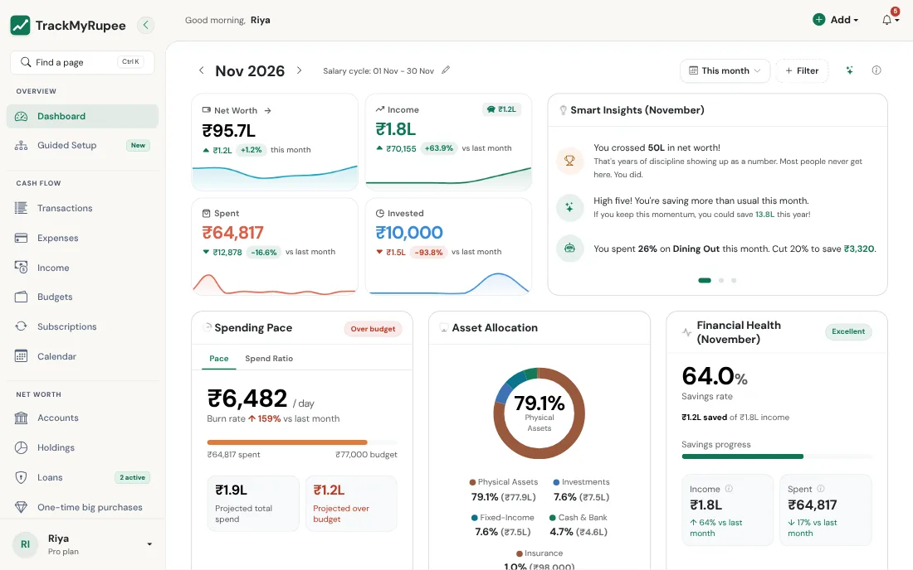
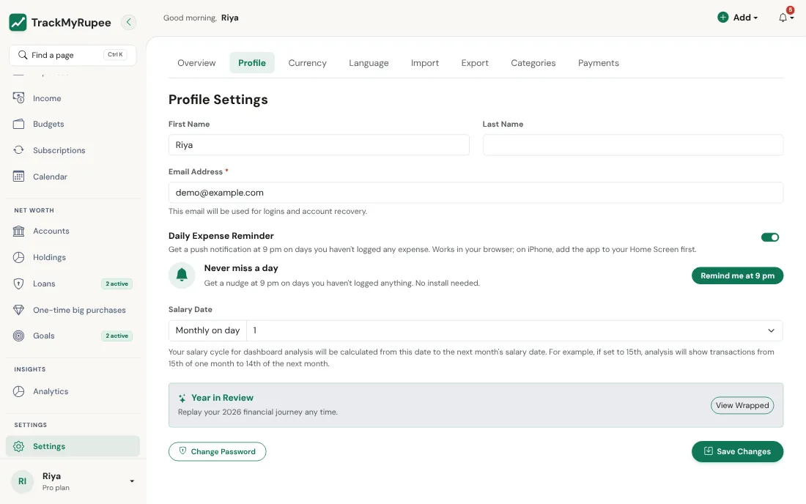
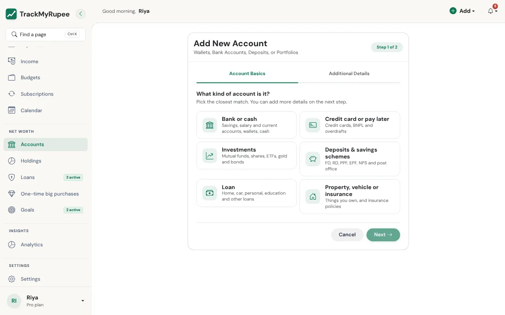
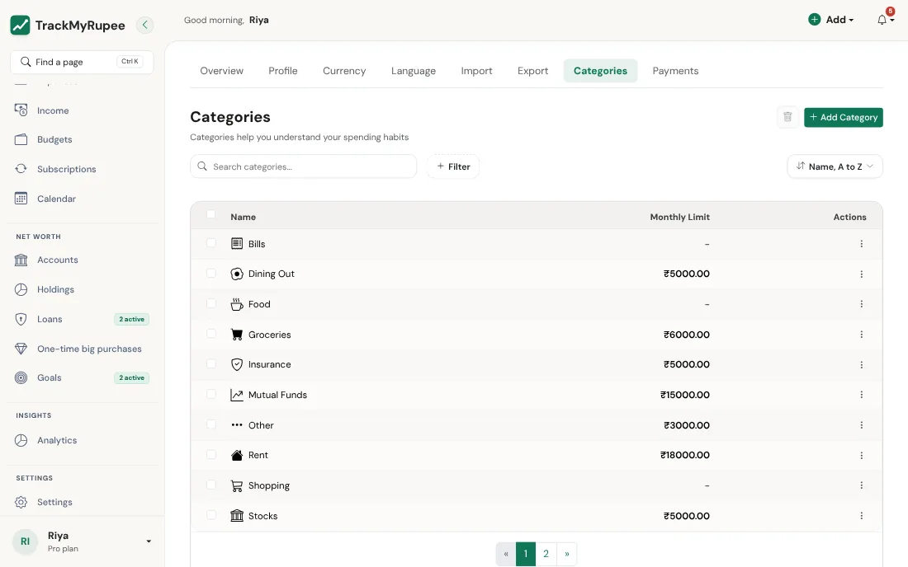
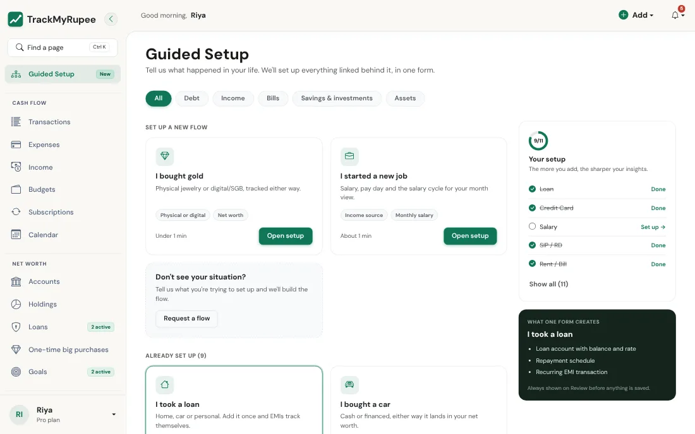

# Getting Started

Set up your accounts, configure your salary cycle, and establish your financial baseline in TrackMyRupee.

---

## 1. First Login

When you open TrackMyRupee for the first time, you can choose between entering demo mode or creating a real account.

{ loading=lazy }

If you enter demo mode, you will see a banner at the top: "You are in Demo Mode. This is a demo with sample data for illustration." The banner has links to create a free account or exit. Demo data is temporary and does not save any changes.

---

## 2. The Setup Wizard

A new account opens a short three-step setup. Every step can be skipped, and you can finish whenever you like.

1. **About you**: pick the description closest to you (Salaried, Freelancer, Family or Student). It tunes the suggestions you see at the end.
2. **Your pay and your money**: your payday (1st to 31st, or the last day of the month), your salary, your bank (or Cash), and the balance you have **right now**. TrackMyRupee creates the account for you ("SBI Savings Account", "Cash Wallet" and so on), logs your salary as income on the first day of your current pay cycle, and, if you leave **Auto-log salary** on, sets up a monthly recurring entry so it is added every month. The balance you type is exactly what your account shows afterwards. If you already have an account with that name, it is reused and **keeps its balance** unless you type a new one.
3. **Your first expense**: type something like "250 chai". The amount must be more than zero, and it is filed under one of your categories (a new one is created if the name is new). Pressing **Back** and changing your answers updates what was created; it never makes duplicates.

At the end you get a **Next steps** checklist, tailored to what you picked: anything you skipped (payday, salary, account, first expense) comes first, then suggestions such as adding a credit card, a loan, a savings goal or SIPs. Dismiss it any time; it is only a list of suggestions.

If something is wrong with an answer (say, an amount of zero), the step shows a message and nothing is saved.

### The first-visit tour

The first time you open the Dashboard after the wizard, a short tour points out where things are. On a computer it has eight stops: the **Add** menu, Transactions, Accounts, Analytics, Guided Setup, page search and Settings. On a phone it has four: the **+** button, the bottom bar, and **More**. Close it at any point and it does not come back by itself. To see it again, open **Settings → Tutorial**.

### Getting around on a phone

The bottom bar names each page under its icon: **Dashboard**, **Transactions**, **Accounts** and **More**, with the **+** button beside it for adding things. **More** holds everything else, in two groups: **Everyday** (Expenses, Income, Budgets, Subscriptions, Calendar, Analytics) and **Money & plans** (Holdings, Loans, Goals, Big purchases, Family, Guided Setup). Alerts, Settings, Legal, Theme and Logout sit underneath.

---

## 3. Setting the Salary Cycle Start Date

Find the pencil icon next to "Salary cycle: 01 Aug - 31 Aug" on the Dashboard. Click it and enter the day of the month when your salary typically arrives (for example, 28).

{ loading=lazy }

Do this before logging any transactions. Every budget period calculation depends on this date matching how money actually flows into your account.

---

## 4. Creating Your First Account

Navigate to **Sidebar → Accounts → Add** on desktop, or **Bottom tab → Accounts → Add** on mobile.

{ loading=lazy }

The form works as a two-step wizard:

1. **Account Basics**: Enter Account Name, Account Type, Currency, and Initial Balance.
2. **Type-specific step**: Fill in fields that apply to your account type.

Use these account types as a guide:

- **Cash Wallet** for physical cash you carry
- **Savings Account** or **Salary Account** for your bank accounts
- **Demat Account** or **Mutual Funds** for investment accounts

---

## 5. Setting an Accurate Opening Balance

The opening balance you enter becomes the base that every future net worth calculation builds on. Enter the exact real-world balance of that account on the day you set it up.

If you set an incorrect opening balance and correct it later, all historical net worth data points will change.

!!! tip "Create all accounts before your first transaction"
    Add every real-world account you own, including a Cash Wallet for physical cash, before logging your first transaction. Every expense and income entry must be attached to an account. Having them all set up from the start means your Day 1 net worth is accurate rather than artificially low.

---

## 6. Default Categories

When you sign up, three default expense categories are created automatically: Food, Shopping, and Bills. You can edit, rename, or add more categories at any time in **Settings → Categories**.

{ loading=lazy }

!!! example "Real-world use case"
    Ananya joins TrackMyRupee for the first time. She has an HDFC Salary Account (balance: Rs. 42,000), an SBI Savings Account (balance: Rs. 1,15,000), and Rs. 3,500 cash in her wallet. She creates all three accounts before logging a single transaction, using Salary Account for HDFC, Savings Account for SBI, and Cash Wallet for physical cash. Her Day 1 net worth shows Rs. 1,60,500, which is an accurate baseline she can track against going forward.

---

## 7. A Faster Way to Set Everything Up

Once your first account exists, the quickest way to cover the rest of your money is **Guided Setup**, found in the sidebar. Instead of filling separate forms for your salary, rent, loans, cards, and investments, you answer one short form per life event, such as "I started a new job" or "I took a loan", and everything connected to it is created for you.

{ loading=lazy }

A good first four are, in this order:

1. [I started a new job](../13-tmr-flows/income-and-bills.md#i-started-a-new-job), which also sets your salary cycle (see section 3)
2. [I pay rent](../13-tmr-flows/income-and-bills.md#i-pay-rent)
3. [I took a loan](../13-tmr-flows/debt.md#i-took-a-loan), if you have one
4. [I got a credit card](../13-tmr-flows/debt.md#i-got-a-credit-card), if you have one

See [Guided Setup](../13-tmr-flows/index.md) for the full tour.

---

## Related Links
- [Philosophy](../00-philosophy.md)
- [Accounts and Net Worth](../02-accounts/index.md)
- [Adding Expenses](../03-transactions-expenses/index.md)
