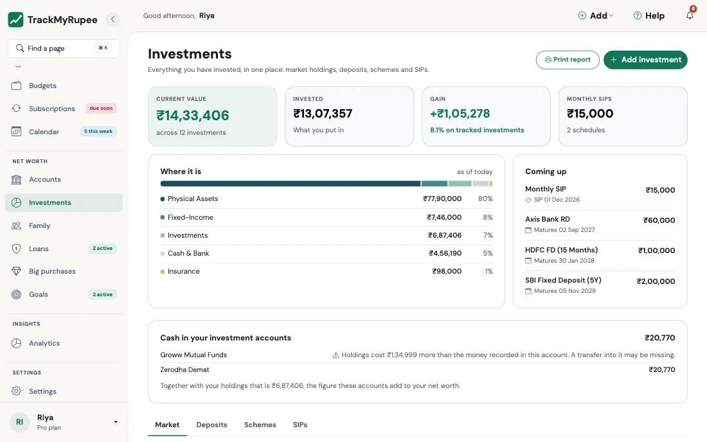
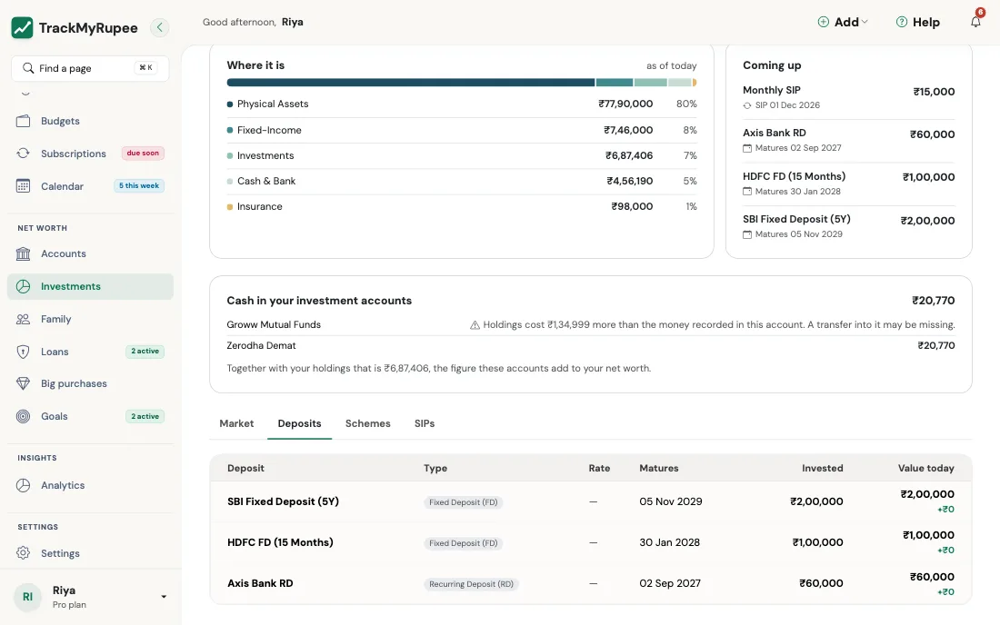
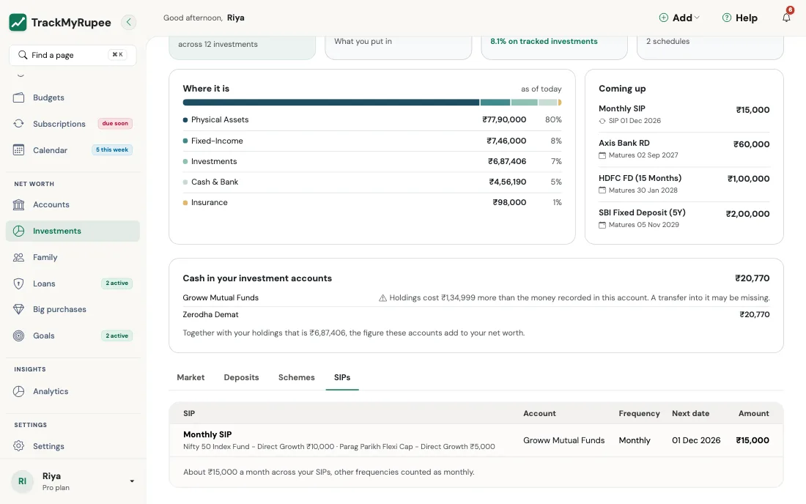

# निवेश, होल्डिंग्स और म्यूचुअल फंड पोर्टफोलियो (Investments)

अपना सारा निवेश एक पृष्ठ पर देखें: बाज़ार होल्डिंग्स, जमा, योजनाएँ और SIP। स्वचालित NAV सिंक्रनाइज़ेशन, SIP ट्रांसफर ट्रैकिंग और सटीक पोर्टफोलियो गणना के साथ वास्तविक समय में अपने म्यूचुअल फंड, स्टॉक और संपत्ति मूल्यांकन को ट्रैक करें।

---

## 1. अवलोकन और नेविगेशन

डेस्कटॉप पर **Sidebar → Net Worth → Investments** के माध्यम से या मोबाइल पर **More → Investments** के माध्यम से अपने निवेश खोलें (URL: `/holdings/`)। इस पृष्ठ का पुराना नाम Holdings था।

### पृष्ठ में क्या दिखता है

- **ऊपर चार आँकड़े**: **Current value** (और वह कितने निवेशों का है), **Invested** (आपने जो लगाया), **Gain** (मौजूदा मूल्य और लगाई गई राशि का अंतर, प्रतिशत के साथ) और **Monthly SIPs** (आपके SIP एक महीने में कुल कितने होते हैं, हर आवृत्ति को मासिक गिनकर)। कुछ का मूल्य दर्ज होने पर ही Gain दिखता है। फ़ोन पर चारों आँकड़े छोटे टाइल के रूप में, एक पंक्ति में दो, दिखते हैं।
- **Where it is**: एक पट्टी और सूची जो दिखाती है कि आपकी संपत्ति खाता-प्रकार के समूहों (Cash & Bank, Investments, Fixed-Income आदि) में कैसे बँटी है, हर एक की राशि और हिस्से के साथ। लोन और कार्ड इसमें नहीं गिने जाते।
- **Coming up**: परिपक्व होने वाली अगली जमा और योजनाएँ, और अगले 30 दिनों में देय SIP, जो सबसे पहले आता है वह ऊपर। कुछ न हो तो यह नहीं दिखता।
- **Print report**: छपने योग्य सार रिपोर्ट खोलता है, जिसमें इस पृष्ठ और आपकी निवल संपत्ति जैसे ही आँकड़े हैं।

इस पृष्ठ, सार रिपोर्ट और निवल संपत्ति के आँकड़े एक ही गणना से आते हैं, इसलिए वे एक-दूसरे से अलग नहीं हो सकते।

{ loading=lazy }

### टैब

- **Market**: आपके म्यूचुअल फंड, स्टॉक और अन्य होल्डिंग्स, इकाइयों, औसत लागत, मौजूदा मूल्य और लाभ के साथ, और खरीदने, बेचने, नाम बदलने या भाव ताज़ा करने की क्रियाएँ।
- **Deposits**: आपकी सावधि और आवर्ती जमाएँ, उनके प्रकार, ब्याज दर, परिपक्वता तिथि, लगाई गई राशि और आज के मूल्य व लाभ के साथ।
- **Schemes**: PPF, EPF, VPF, NPS, सुकन्या समृद्धि, पोस्ट ऑफ़िस योजनाएँ और ऐसी ही अन्य, जहाँ तय हो वहाँ दर और परिपक्वता, जहाँ पता हो वहाँ लगाई गई राशि, और शेष के साथ।
- **SIPs**: निवेश खाते में हर आवर्ती ट्रांसफ़र, वह कौन-से फ़ंड खरीदता है, उसका खाता, कितनी बार चलता है, अगली तारीख और राशि के साथ। साप्ताहिक या अन्य गैर-मासिक SIP के लिए एक महीने की राशि भी दिखती है।

{ loading=lazy }

{ loading=lazy }

खुला टैब पते में रहता है (जैसे `/holdings/#deposits`), इसलिए रीफ़्रेश या साझा लिंक उसी टैब पर लौटता है। हर जमा, योजना और SIP उसका खाता खोलता है।

---

## 2. NAV गणना और पोर्टफोलियो मीट्रिक कैसे काम करते हैं

TrackMyRupee आपकी वास्तविक समय की निवेश निवल संपत्ति की सटीक गणना करने के लिए एक बहु-स्तरीय मूल्यांकन इंजन का उपयोग करता है।

### मूल्यांकन समाधान क्रम

किसी भी सक्रिय होल्डिंग के लिए, वर्तमान इकाई मूल्य का समाधान प्राथमिकताओं के निम्नलिखित क्रम का उपयोग करके किया जाता है:

1. **लाइव दैनिक NAV**: फंड के 6-अंकीय AMFI स्कीम कोड का उपयोग करके आधिकारिक AMFI और `MFapi.in` लाइव फ़ीड से स्वचालित रूप से प्राप्त किया गया।
2. **कैश्ड NAV फॉलबैक**: यदि लाइव API अस्थायी रूप से पहुंच योग्य नहीं है, तो TrackMyRupee स्थानीय फंड कैश से नवीनतम कैश्ड NAV पुनर्प्राप्त करता है।
3. **लागत आधार फॉलबैक**: यदि अभी तक कोई NAV कैश मौजूद नहीं है (उदाहरण के लिए, एक नई जोड़ी गई होल्डिंग), तो मूल्यांकन आपकी खरीद लागत आधार (इकाइयां x औसत लागत) पर वापस आ जाता है।

### सूत्र

- **होल्डिंग मूल्यांकन**

  $$\text{Current Valuation} = \text{Units} \times \text{Latest Unit NAV}$$

- **खाता कुल शेष राशि**

  $$\text{Cost Basis Total} = \sum \left( \text{Units}_i \times \text{Average Cost}_i \right)$$

  $$\text{Uninvested Cash} = \max\left(0, \text{Ledger Balance} - \text{Cost Basis Total}\right)$$

  $$\text{Total Account Balance} = \sum \left( \text{Units}_i \times \text{Latest Unit NAV}_i \right) + \text{Uninvested Cash}$$

!!! note "सुधार लागू"
    अगस्त 2026 से पहले, लॉग की गई होल्डिंग्स के बाद ट्रांसफर किया गया कैश दो बार गिना जा सकता था। अब यह गणना सही कर दी गई है।

- **कुल लागत आधार**

  $$\text{Total Invested} = \sum \left( \text{Units}_i \times \text{Average Cost}_i \right)$$

- **अप्रत्यक्ष लाभ / हानि**

  $$\text{Unrealized Gain} = \text{Total Portfolio Valuation} - \text{Total Invested Cost}$$

- **वृद्धि रिटर्न प्रतिशत**

  $$\text{Gain \%} = \left( \frac{\text{Unrealized Gain}}{\text{Total Invested Cost}} \right) \times 100$$

---

## 3. SIP के लिए आवर्ती हस्तांतरण कैसे सेट करें

एक **सिस्टमैटिक इन्वेस्टमेंट प्लान (SIP)** में आपके प्राथमिक बैंक खाते से आपके म्यूचुअल फंड खाते में नियमित रूप से एक निश्चित राशि (उदाहरण के लिए, ₹5,000 मासिक) स्थानांतरित करना शामिल है।

### चरण-दर-चरण SIP सेटअप

1. **Add → Add Subscription** (या **Sidebar → Subscriptions → Add**) पर जाएं।
2. **Transaction Type** को `TRANSFER` पर सेट करें।
3. **Description** को अपने SIP नाम (उदाहरण के लिए, "Monthly SIP - Parag Parikh Flexi Cap") पर सेट करें।
4. **Amount** को अपने मासिक SIP आवंटन (उदाहरण के लिए, `5000`) पर सेट करें।
5. **From Account** को अपने बैंक खाते (उदाहरण के लिए, HDFC Salary Account) पर सेट करें।
6. **To Account** को अपने निवेश खाते (उदाहरण के लिए, Mutual Funds / Zerodha Coin) पर सेट करें।
7. **Frequency** को `Monthly` पर सेट करें और अपनी SIP प्रारंभ तिथि चुनें।
8. **Buy funds each time** में हर उस फंड के लिए एक पंक्ति जोड़ें जिसे किस्त खरीदती है और उसकी राशि भरें, जैसे ₹45,000 की SIP में तीन फंड के लिए ₹15,000-₹15,000। हर किस्त हर फंड की एक खरीद के रूप में दर्ज होती है और NAV से आंकी जाती है। खाली छोड़ने पर केवल हस्तांतरण दर्ज होता है।
9. **Save Subscription** पर क्लिक करें।

!!! info "SIP हस्तांतरण आपकी शेष राशि को कैसे प्रभावित करता है"
  प्रत्येक अनुसूचित तिथि पर, TrackMyRupee स्वचालित रूप से एक आंतरिक हस्तांतरण लॉग करता है। पैसा आपके बैंक खाते से निकलकर म्यूचुअल फंड खाते में लेजर कैश के रूप में आता है। आपकी कुल निवल संपत्ति तुरंत नहीं बदलती क्योंकि पैसा आपके अपने खातों में ही रहता है। जब आप संबंधित होल्डिंग लॉग करते हैं, तो वह हिस्सा अलग कैश की तरह नहीं, बल्कि होल्डिंग वैल्यू में गिना जाता है। जो राशि अभी होल्डिंग में आवंटित नहीं हुई है, वही uninvested cash के रूप में दिखती रहती है।

---

## 4. होल्डिंग्स और इकाइयों को कैसे अपडेट किया जाता है

जैसे ही आपका SIP निष्पादित होता है या जब आप एकमुश्त निवेश करते हैं, तो आपकी होल्डिंग्स दो अलग-अलग तरीकों से अपडेट होती हैं।

### इकाइयाँ और खरीद मूल्य अपडेट करना

जब AMC द्वारा नई इकाइयाँ आवंटित की जाती हैं:

1. **Holdings** (`/holdings/`) या अपने खाते के विवरण पृष्ठ पर जाएँ।
2. **Add Holding** पर क्लिक करें (या अपडेट करने के लिए अपनी मौजूदा होल्डिंग खोलें)।
3. अपनी अद्यतन संचयी **Units** और अद्यतन औसत खरीद मूल्य (**Avg Cost**) दर्ज करें।
4. सिस्टम आपकी लागत के आधार को तुरंत अपडेट करता है:
   $$\text{New Cost Basis} = \text{Updated Units} \times \text{New Avg Cost}$$

### स्वचालित दैनिक NAV अपडेट

- **स्वचालित बैकग्राउंड सिंक**: TrackMyRupee दैनिक बैकग्राउंड जॉब चलाता है जो भारतीय बाजार बंद होने के समय (लगभग रात 11 बजे IST) के बाद अद्यतन NAV खींचता है।
- **मैनुअल इंस्टेंट रिफ्रेश**: तत्काल लाइव प्राप्त करने के लिए किसी भी होल्डिंग पंक्ति के बगल में **Refresh NAV** आइकन पर क्लिक करें।

### स्टॉक, ETF या गोल्ड होल्डिंग की कीमत तय करना

जिस होल्डिंग का स्कीम कोड नहीं है, उसका कोई दैनिक NAV नहीं होता। उसके तीन-बिंदु मेनू में **Update value** चुनें, **प्रति यूनिट वर्तमान कीमत** और तारीख भरें और सेव करें। मूल्य = आपकी यूनिट × वह कीमत, इसलिए बाद में यूनिट बढ़ाने पर भी सही रहता है। उसी तारीख की कीमत दोबारा भरने पर वह बदल जाती है। होल्डिंग केवल Mutual Fund, Demat, ETF, SGB, ULIP और Gold खातों में जोड़ी जा सकती हैं; NPS, PPF, EPF और डिपॉज़िट खाते अपने शेष और ब्याज से आंके जाते हैं।

### और खरीदना, बदलना और खरीद का इतिहास

होल्डिंग के नाम पर क्लिक करें (या उसके तीन-बिंदु मेनू में **Purchases**) तो उसका पेज खुलता है: मूल्य, लगाई गई राशि, लाभ और हर खरीद। **Buy more** में तारीख और **Units**, **Price / unit**, **Amount** में से कोई दो भरें, तीसरा अपने आप भर जाता है। खरीद को आपके हस्तांतरण से जोड़ने के लिए **Paid by transfer** चुनें। हर खरीद को बदला या हटाया जा सकता है; होल्डिंग की यूनिट और औसत लागत खरीदों से अपने आप दोबारा निकलती हैं। होल्डिंग में कम से कम एक खरीद रहती है।

### खरीद को कौन सा NAV मिलता है

म्यूचुअल फंड खरीद को उस NAV पर आंकता है जो इस पर निर्भर है कि आपका पैसा फंड तक कब पहुंचा। अगर आप केवल **Amount** भरते हैं (**Buy more** में या हस्तांतरण के **Allocate to funds** में), तो यूनिट अपने आप निकल आती हैं: कारोबारी दिन **दोपहर 3 बजे** से पहले पैसा पहुंचे तो उसी दिन का NAV (लिक्विड और ओवरनाइट फंड में **1:30 बजे** से पहले, तो पिछले कारोबारी दिन का NAV); बाद में, या सप्ताहांत/छुट्टी पर, अगले कारोबारी दिन का NAV। फिर **0.005% स्टाम्प ड्यूटी** घटाकर शेष राशि को NAV से भाग दिया जाता है और यूनिट तीन दशमलव तक गोल होती हैं। उदाहरण: ₹10,000 और NAV ₹50 पर (10,000 - 0.50) / 50 = **199.990 यूनिट**।

जिस दिन का NAV अभी प्रकाशित नहीं हुआ, उसकी खरीद **Waiting for NAV** दिखती है और NAV आते ही यूनिट अपने आप जुड़ जाती हैं। इस तरह निकली यूनिट **Estimated** कहलाती हैं; अपने फंड हाउस के स्टेटमेंट से मिलाकर खरीद को बदलें और यूनिट भरें तो वह **Confirmed** हो जाती है। स्टॉक, ETF और गोल्ड के लिए यूनिट खुद भरनी होती हैं।

### बेचना

होल्डिंग खोलकर **Sell** दबाएं। तारीख और बेची गई **Units**, **Price / unit** और मिली **Amount** में से कोई दो भरें, तीसरा अपने आप भर जाता है। उस तारीख पर आपके पास जितनी यूनिट थीं उससे ज़्यादा नहीं बेच सकते।

पैसा खाते में **नकदी (Uninvested cash)** के रूप में रहता है। बेची गई यूनिट की औसत लागत घटाकर जो लाभ होता है वह उसी तारीख पर खाते में **Investment Returns** आय के रूप में, और हानि पूंजीगत घटना (capital event) के रूप में दर्ज होती है, ताकि यूनिट बिकने के बाद भी आपकी निवल संपत्ति में लाभ बना रहे। बिक्री औसत लागत पर हो तो कुछ दर्ज नहीं होता। बची यूनिट और औसत लागत फिर से निकाली जाती हैं; सब बेचने पर होल्डिंग सूची से हट जाती है। एग्ज़िट लोड, ब्रोकरेज और टैक्स की गणना नहीं होती: जो राशि वास्तव में मिली वही भरें।

निवेश खाते के पेज पर **Invested in holdings** और **Uninvested cash** दिखते हैं। अगर होल्डिंग की लागत खाते में दर्ज पैसे से ज़्यादा है, तो चेतावनी दिखती है कि खाते में किसी हस्तांतरण की प्रविष्टि छूटी हो सकती है।

---

## संबंधित लिंक
- [खाते और निवल संपत्ति](index.hi.md)
- [आवर्ती लेनदेन और सदस्यताएँ](../05-transactions-recurring/index.hi.md)
- [हस्तांतरण और आंतरिक गतिविधियां](../06-transfers/index.hi.md)
- [विश्लेषण और वित्तीय स्वास्थ्य](../11-analytics-and-health/index.hi.md)
