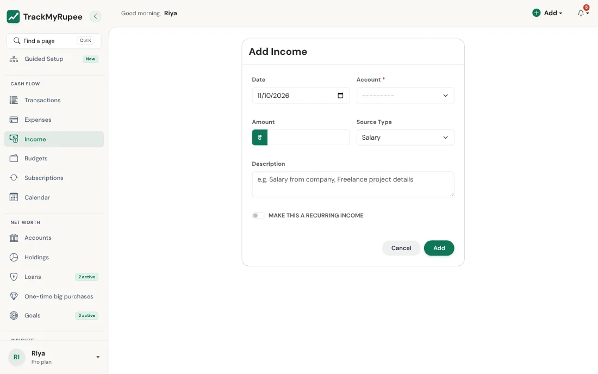
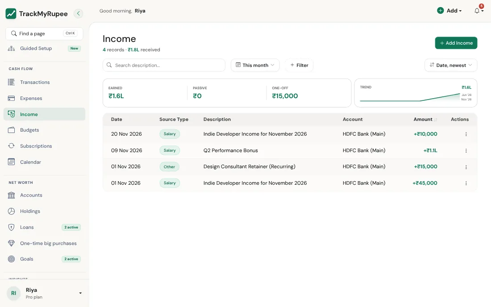

# Adding Income

Log every payment you receive so your savings rate, analytics, and net worth stay accurate.

---

## 1. Opening the Income Form

{ loading=lazy }

- **Desktop**: Click **Add** in the top navbar, then select **Add Income**.
- **Mobile**: Tap the **+** button in the bottom tab bar, then tap **Add Income**.

You can also navigate to **Sidebar → Income → Add** on desktop.

---

## 2. Choosing a Source Type

The **Source Type** field tells the app what kind of income this is. Choose the option that best describes the payment:

| Source Type | When to use it |
|---|---|
| Salary | Your regular monthly salary |
| Freelance / Consulting | Project fees or consulting payments |
| Business | Revenue from your own business |
| Investment Returns | Dividends, interest, or capital gains |
| Rental Income | Rent received from tenants |
| Cashback and Rewards | Credit card cashback or loyalty rewards |
| Refund / Reimbursement | Money returned to you (expense refund, bill reimbursement) |
| Other | Anything that does not fit the above |

!!! info "Why source type matters"
    The app separates your predictable income (Salary) from one-off receipts (Refund / Reimbursement) when calculating your savings rate. Cashback and Rewards and Refund / Reimbursement types are excluded from the savings rate denominator so they do not inflate your rate artificially. A refund you [link to the expense or big purchase it paid back](#4-refunds-and-reimbursements-link-them-to-what-they-paid-back) is not income at all.

---

## 3. Filling the Form

Complete the following fields:

1. **Date**: When the money arrived.
2. **Account** (required): Which account the money landed in. The income is added to that account's balance. If you forget to choose one, the form asks you to pick an account and nothing is saved.
3. **Amount and currency**: One joined field. The box on the left shows the currency (your profile currency to begin with); click it to choose another, and type to search the list (for example `usd`). Then type the amount. Digits are grouped as you type, the way that currency is written: `100000` becomes **1,00,000** for the rupee and **100,000** for the others. You only type digits, and the plain number is what is saved.
4. **Source Type**: Select from the list above.
5. **Refund for** (only for Refund / Reimbursement): What this refund paid back. See [Refunds and Reimbursements](#4-refunds-and-reimbursements-link-them-to-what-they-paid-back).
6. **Description** (optional): A short note, such as the client name or invoice number.

If this income repeats, tick **Make this a recurring income** and choose the **Frequency** (it is required once the box is ticked). This creates a subscription that auto-posts the income going forward without any manual entry. The entry you are saving counts as the first one, so it is not posted twice.

!!! note "One schedule per source type"
    TrackMyRupee keeps a single active recurring schedule for each source type. If you tick the box again for a source type that already has one (for example when your retainer goes up), the existing schedule is **updated** with the new amount, frequency, and start date instead of a second one being created.

The form checks that:

- the **amount** is greater than zero, and
- the **date** is not in the future.

Click **Save** when done.

---

## 4. Refunds and Reimbursements: Link Them to What They Paid Back

Say you paid Rs. 20,000 for a trip stay for four friends, and they sent you back Rs. 15,000. Your real cost was Rs. 5,000. If you simply log the Rs. 15,000 as income, your income looks higher than it was and the Rs. 20,000 still sits in your spending as if it were all yours.

Link the refund to what it paid back instead. When you choose **Refund / Reimbursement** as the Source Type, a **Refund for** search box appears:

- **Not linked to anything** is the default and is always the first choice. The money counts as ordinary income, exactly as before.
- Below it, the **5 most recent expenses and big purchases** are listed together, newest first, each tagged **Expense** or **big purchase**. Tap or click one to link the refund to it.
- To find something older, **type**. The search covers both your expenses and your big purchases: the description or note, the category, the amount (commas are ignored), the date, and a big purchase's type.
- The chosen item shows in the box with an **x** to unlink it again.

Once linked:

- The refund is **not counted as income**: not on the Dashboard, in the savings rate, on the Transactions page, in your emails, or in Analytics.
- The expense (or big purchase) counts for **what it really cost**: its amount less everything refunded against it. In the example, the trip shows Rs. 5,000, in the month it was spent, in its own category and against its own budget.
- Your account balance still goes **up** by the amount you received, because the money really arrived.

!!! info "Which month does it count in?"
    A refund reduces the **expense it paid back**, in that expense's own month, not the month the refund arrived. So a dinner on 20 October, repaid on 3 November, shows its real cost in October. For a big purchase that you counted in your averages, the refund comes off in the month it arrived.

A few rules keep the numbers honest:

- You can only link to your own entries, and a refund pays back **one** thing: an expense or a big purchase, not both.
- The refunds against one expense, or one big purchase, cannot add up to more than what it cost, whatever currency the refund is in (the comparison is made in your own currency). The form tells you how much can still be refunded.
- An expense that has had money paid back cannot be edited to cost less than what came back. Change or remove the refund first.
- If you [convert an expense to a big purchase](../03-transactions-expenses/index.md), the refunds already linked to it move with it.
- Budgets follow the same rule as the Dashboard: a big purchase counted in your budget is reduced by what was refunded against it, in the month the refund arrived. The Calendar takes the refund off the day it arrived.
- Changing your base currency in Settings converts the refunds along with everything else, so the net cost stays right.
- Delete the expense and its refunds count as ordinary income again, because there is nothing left for them to pay back.
- The **Expenses** and **big purchases** lists show "refunded" and "Net" under an amount that has refunds, and each has an **Add refund** action in its menu that opens this form with the item already chosen. Opening an expense or big purchase for editing lists its refunds too.

To link a refund you already saved without a link, open it from the Income list, choose **Refund / Reimbursement**, pick what it paid back, and save.

!!! example "Real-world use case"
    On a Goa trip, Meera pays the Rs. 20,000 villa advance and logs it as a big purchase. Back home, her three friends send Rs. 15,000 between them. She logs it as income with Source Type **Refund / Reimbursement**, types `villa` in **Refund for**, and picks the villa advance. Her savings and Dashboard no longer show Rs. 15,000 of extra income, and the villa now shows as Rs. 5,000 net, which is her real share. Her bank balance is still correct, because the money did arrive.

---

## 5. Where the Income Appears

After saving, the income entry appears in:

{ loading=lazy }

- The **Income** list at `/income/list/`, newest first
- The **Dashboard** Income tile for the current period
- The **Analytics** charts for year-to-date totals
- The balance of the account you chose, which goes **up** by the amount

### The Income page

The page opens on the current period and shows three totals for whatever you are looking at, based on the three kinds of income:

| Total | Source types it adds up |
|---|---|
| **Earned** | Salary, Freelance / Consulting, Business |
| **Passive** | Investment Returns, Rental Income |
| **One-off** | Cashback and Rewards, Refund / Reimbursement, Other |

Next to the totals, a small chart shows your **Earned** income for the last six months, so you can see at a glance whether your regular income is steady. Passive and one-off income are not in that chart.

The Income page shows **money received**, so a refund you linked still appears in this list and in these totals: it did arrive. It is the Dashboard, the savings rate, and the other reports that leave it out, because it is not income.

You can search the description, filter by source type, income group, account, or amount, and sort by date or amount. See [Search and Filters](../14-filters-and-search/index.md). Income in another currency is converted to your own currency at the rate of the day you save it, and the totals use the converted amounts.

---

## 6. Editing or Deleting an Income Entry

Find the entry in the Income list. Click or tap it to open the edit form. Change any field and click **Save** to apply the update. The account balance is corrected automatically: change the amount and it moves only by the difference, move the entry to another account and the money moves with it.

To delete, use the delete action on the income detail screen and confirm the prompt. The amount is taken back out of the account.

!!! example "Real-world use case"
    Vikram is a freelance designer. On the 1st he logs his Rs. 45,000 monthly retainer as Source Type: Freelance / Consulting and ticks Make this a recurring income with Monthly frequency, so it auto-posts every month. On the 20th he receives a one-off Rs. 10,000 project bonus and logs it manually as Freelance / Consulting without the recurring box ticked. Keeping them separate means his income list clearly shows the regular retainer versus the one-off bonus, and Analytics does not treat the bonus month as his new normal.

---

## Related Links
- [Adding Expenses](../03-transactions-expenses/index.md)
- [big purchases](../09-capital-events/index.md)
- [Recurring Transactions and Subscriptions](../05-transactions-recurring/index.md)
- [Analytics: Spending, Cashflow and Net Worth](../11-analytics-and-health/index.md)
