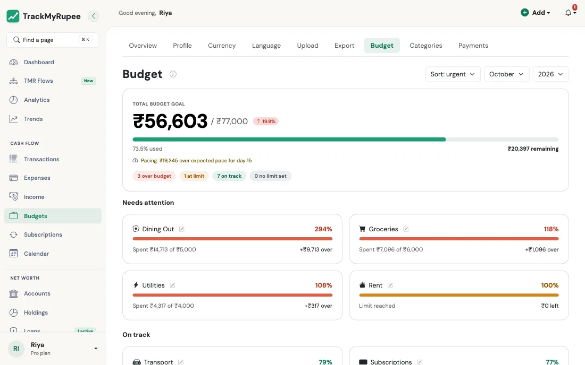

# Budgets

Set a spending limit for each category, see how much you can safely spend today, and get alerted before you overshoot.

---

## 1. Opening the Budgets Page

Navigate to **Sidebar → Budgets** on desktop, or go to **More → Budgets** from the mobile bottom sheet.

{ loading=lazy }

From top to bottom the page shows:

1. **A header** with the month picker (arrows or the drop-down), the sort menu and **+ New budget**.
2. **The hero card.** For the current month it shows **Safe to spend today** (what is left of your budget divided by the days left, today included), how you are doing against an even pace, and a ring showing how much of the whole budget is used.
3. **Status chips**: how many categories are over budget, at their limit, on track, or have no limit.
4. **Needs attention**, then **On track**, then **No limit set**.

Past months show a **Month summary** instead of a daily amount (there is nothing left to pace). Future months show the **Planned budget** and the limits only.

### What counts as spending in a category

For the month you are looking at, a category's spend is:

- every **expense** in that category, including the ones your subscriptions post automatically, converted to your own currency (the category name is matched ignoring capital letters, so *food* counts towards *Food*), plus
- any **Capital Event** whose **Exclude from Budget** switch is turned off. It counts towards the category with the same name as its subtype (for example *Large Purchase*). By default capital events are excluded. See [Capital Events](../09-capital-events/index.md).

Loan interest and transfers are not budget spending.

### The numbers at the top

| Number | What it means |
|---|---|
| **Total budget** | The limits of all categories that have a limit, added up. It is never stored separately. |
| **Spent** | Spend in those categories only |
| **Not in budget** | Everything else you spent this month: categories with no limit, and expenses whose category no longer exists |
| **Safe to spend today** | Remaining budget divided by the days left in the month, including today. It is never negative: when nothing is left it shows 0 and says you are over budget. |
| **Expected pace** | Your total budget spread evenly over the days of the month, up to today |

---

## 2. Changing a Limit

Limits are **per category and per month**, and they **repeat by default**: a limit applies from the month you set it until you change it.

1. Click **Adjust limit** on a card in *Needs attention*, or the **pencil icon** on any category (or **+ Set limit** on a category without one).
2. Type the new monthly limit.
3. Choose how far it reaches:
    - **This month only** changes just the month you are viewing.
    - **Every month** changes this month and every month after it.
4. A line under the toggle shows exactly what will happen, for example *Food: ₹5,000 → ₹6,000 for Oct 2026*. Click **Save**.

Adjust limit opens as a dialog on desktop and as a sheet from the bottom on a phone. **Remove limit** works the same way and follows the same choice.

!!! info "Past months keep their limit"
    Changing a limit never rewrites a month that is already over. **Every month** is only offered for the current or a future month. You can still correct a past month with **This month only**.

!!! note "A change for one month only"
    A category changed for just one month shows **Changed for this month** with **Reset to default**. One tap puts it back on the repeating limit. If a later month has its own limit, the card says so.

### Funding a higher limit from another category

If you raise a limit, open **Fund this from another category**, pick a category that has room, and the same amount is taken off that one. Your total budget does not change.

### Setting several limits at once

**Set all limits** (in the *No limit set* box) lists every category without a limit so you can fill in several amounts and save them together in one go: if any amount is invalid, nothing is saved, so you never end up with half the limits set. They apply from the month you are viewing onward.

### Lowering a limit below what you have spent

This is allowed. The category simply shows as over budget.

!!! note "Renaming and deleting categories"
    Renaming a category renames it on all your expenses, subscriptions and quick-add suggestions too, and its limit history follows it. If you delete a category, its expenses are kept but no longer belong to any budget, so they show up as unbudgeted spend. Its past limits are kept, so earlier months still look the way they did.

### How many categories you can budget

The number of categories depends on your plan: **Free 5, Plus 15, Pro unlimited**. On Free and Plus, your oldest categories up to that number are usable. Any extra ones are locked: you cannot change their limits (not even from the category form), they are not offered when you add an expense, they do not appear on the Budget page, and they send no alerts.

---

## 3. Reading the "Needs Attention" Section

Each category has one of four states, shown by an icon and a label as well as a colour:

| State | When | Colour |
|---|---|---|
| **Over budget** | You have spent **more than** the limit | Red |
| **At limit** | You have used **85 percent or more** of the limit, up to and including exactly the limit | Amber |
| **On track** | Under 85 percent of the limit | Green |
| **No limit** | No limit is set | No bar |

The **Needs attention** section lists the categories that are over budget or at their limit, most urgent first. In **On track**, categories you have spent in come first and untouched ones are shown dimmed; on a phone they are folded behind **Show N more untouched**. The same 85 percent rule colours the category bars on your Dashboard, and it is also when you get an alert.

### Budget alerts

You get a notification when a category first reaches **85 percent** of its limit ("Budget Alert") and another when it goes **over** ("Budget Exceeded"). Each is sent at most once per category per month, and uses the limit that applies to that month. Categories with no limit, and locked categories, never send alerts.

### Pace

For the current month the hero card compares your spending so far with spending the whole budget evenly across the days of the month. If you are more than 5 percent of your total budget ahead of that even pace it tells you how much over pace you are. If you are more than 5 percent behind it, it tells you how much under. Otherwise it says you are on pace.

### Smart move suggestions

When a category has reached its limit and another category has used **under 10 percent of its limit for each of the last three months** (and is still barely used), a **Smart move** banner offers to move some of the unused limit across for this month. **Review suggestion** opens the usual dialog with the numbers filled in. The banner never appears unless your history supports it, and **Dismiss** hides that suggestion for good.

---

## 4. Choosing a Month

Use the arrows or the drop-down at the top to move between months. The page updates in place without reloading. The sort menu orders categories by urgency, amount spent, limit or name. The budget is always one calendar month at a time.

!!! example "Real-world use case"
    Mid-month, Pooja sees her Dining Out card has reached 210 percent of its Rs. 5,000 limit. It is a special month, so she taps **Adjust limit**, enters Rs. 10,000 and keeps **This month only**. Next month Dining Out is back at Rs. 5,000 on its own, and last month still looks exactly as it did. Later she decides the higher amount is the new normal, edits it again and picks **Every month**.

---

## Related Links
- [Adding Expenses](../03-transactions-expenses/index.md)
- [Analytics, Trends and Financial Health](../11-analytics-and-health/index.md)
