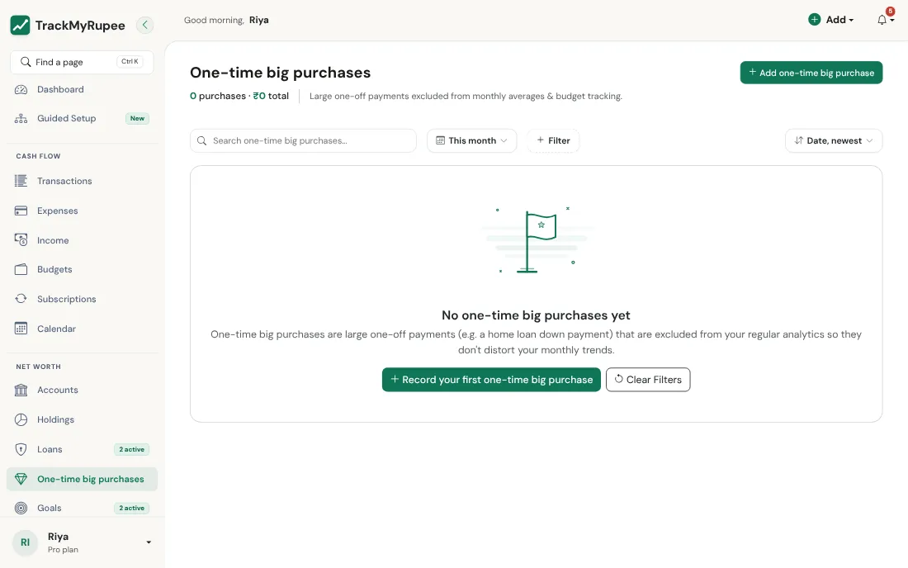
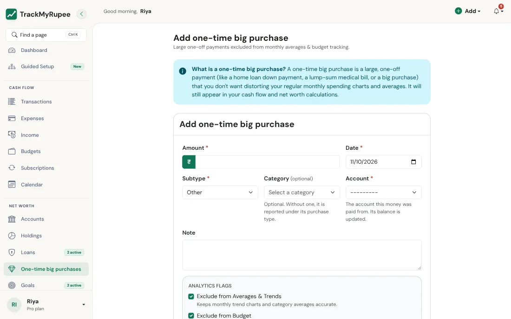
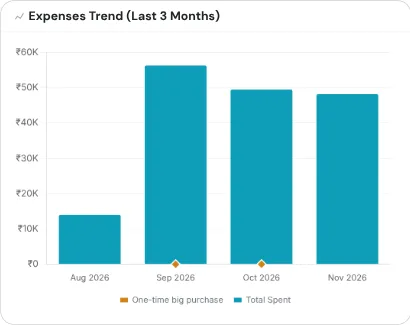

# One-time big purchases

Record large, one-time payments without distorting your regular monthly expense analytics.

---

## 1. What Is a One-Time Big Purchase

A one-time big purchase is a large, one-off payment that you do not want skewing your regular monthly spending charts.

Examples include a home loan down payment, a lump-sum medical bill, a car purchase, or a big renovation payment.

The rule of thumb is this: if the amount is large enough to make your average monthly expense chart look abnormal for several months, log it as a one-time big purchase instead of a regular expense.

---

## 2. What a One-Time Big Purchase Does (and the Three Switches)

By default a one-time big purchase is **kept out of your everyday numbers but still moves your money**. Three switches on the form control this. They are all on when you start, and you can change each one per event:

| Switch | When it is **on** (the default) | When you turn it **off** |
|---|---|---|
| **Exclude from Averages & Trends** | The event does not count as spending in your monthly totals, your savings rate, or your trend charts. It shows as a small marker on the dashboard charts instead. | It counts as spending for that month, like a regular expense. |
| **Exclude from Budget** | It does not count against your category budgets. | It counts towards the budget for the event's **Category** if you chose one, otherwise for the category with the same name as its subtype (for example *Large Purchase*), on the Budget page, in your Dashboard breakdown, and in budget alerts. |
| **Include in Cash Flow / Net Worth** | The account you chose goes down by the amount, so your balance and net worth stay true. | The account balance is not touched, though the event still records which account it relates to. Use this when the payment was made on your behalf and the money never left that account. |

So the usual one-off payment leaves your Dining Out, Transport, and Groceries budget bars alone, and your Analytics averages keep reflecting your real recurring spend, while your account balance still drops by the right amount.

!!! info "Account balances follow the event"
    Add it and the account goes down. Edit the amount and it changes by the difference. Move it to another account and the money moves with it. Delete it, or turn off **Include in Cash Flow / Net Worth**, and the account gets the money back. If you pick an account in another currency, the account is charged in its own currency.

---

## 3. Opening the One-Time Big Purchase Form

{ loading=lazy }

- **Desktop**: Navigate to **Sidebar → one-time big purchases → Add**.
- **Mobile**: Go to **More → one-time big purchases → Add**.

The form is titled "Add one-time big purchase". You can also start it from an existing expense, see [Converting Between Expenses and one-time big purchases](#7-converting-between-expenses-and-capital-events).

---

## 4. Filling the Form

Complete the following fields:

{ loading=lazy }

1. **Amount** (required): The total amount of the payment. It must be greater than zero.
2. **Currency**: Defaults to your profile currency.
3. **Date** (required): The date the payment was made. It cannot be in the future.
4. **Subtype** (required): What kind of event it is. The choices are **Loan Down Payment, Loan Prepayment, Large Purchase, Medical Lump Sum, Gift Given, Gift Received, Investment Lump Sum,** and **Other**.
5. **Category** (optional): One of your own categories, for example *Electronics* for a laptop. See [Categories and your year-end audit](#categories-and-your-year-end-audit). The Subtype says what kind of event it is. The Category says where the money belongs in your category totals.
6. **Account** (required): The account the money came from. If you forget it, the form shows a message under the field and nothing is saved. This keeps every payment, such as a loan prepayment, traceable to an account.
7. **Linked Loan** (optional): Connect a down payment or prepayment to one of your active loans.
8. **Note** (optional): A short description, such as "Kitchen renovation advance".
9. The three switches described above.

Click **Save** when done.

### Categories and your year-end audit

A one-time big purchase never appears in your everyday expense list, so a total "by category" for the year would normally leave out your biggest purchases. The optional **Category** fixes that:

- **Analytics**: turn on **Include one-time big purchases** (next to the year picker). The *Category distribution* chart then adds every one-time big purchase of that year under its Category, merged with the expenses in the same category. An event with no category appears under its Subtype name (for example *Medical Lump Sum*). The switch is **off by default**, so your usual charts and averages stay as they were. It also adds events you excluded from averages to the monthly bars.
- **Budgets**: an event you did not exclude from the budget counts towards the budget of its Category (or, with none chosen, its Subtype name).
- **One-time big purchases list**: filter by Category like any other filter.
- **Converting**: an expense turned into a one-time big purchase keeps its category, and a one-time big purchase turned back into an expense gets its Category (or its Subtype name if it has none).

Existing events have no category until you edit them. Nothing changes for them.

---

## 5. Linking a One-Time Big Purchase to a Loan

If you are recording a home loan down payment or a lump-sum prepayment on an existing loan, use the **Linked Loan** field to connect the one-time big purchase to that loan record.

Only events with the subtype **Loan Down Payment** or **Loan Prepayment** reduce the loan's remaining principal. Every rupee of one counts as principal paid, on top of what your EMIs have already repaid, so the loan's outstanding balance and your total liabilities both go down. Deleting the event gives the principal back. A linked event with any other subtype is only attached to the loan for reference and does not change the balance. The loan detail page shows the capital payments next to your EMIs.

!!! example "Real-world use case"
    Kavya pays a Rs. 4,00,000 home renovation advance in July. She logs it as a one-time big purchase with Subtype: Large Purchase, Account: HDFC Savings, Amount: 4,00,000, rather than as a regular expense. Her HDFC Savings account balance drops correctly and her net worth reflects the outflow. But her Dining Out, Groceries, and Transport budget bars are unaffected, and the Analytics average monthly expense chart for the rest of the year still shows her real recurring spend instead of a Rs. 4,00,000 spike warping every future month-over-month comparison.

---

## 6. Seeing One-Time Big Purchases on Your Charts

One-time big purchases that are kept out of your spending averages (the default) are not hidden: you still want to see **when** they happened. So they appear on the spending trend charts on your Dashboard as small **amber diamonds sitting on the bottom axis**, directly under the day (or month) they happened. An event you have switched to count as spending is already part of the line, so it gets no diamond.

{ loading=lazy width="463" }

- On the **Daily Expenses** chart (a single month), look for a diamond under the date of the event.
- On the **Expenses Trend** chart (a year), a diamond sits under each month that has an event.
- **Hover** over that day or month, and the tooltip lists the event by name and amount alongside the usual figures, for example *Investment Lump Sum, ₹1L*.
- The chart legend has a matching **one-time big purchase** entry, so the diamond is never a mystery.

A diamond never changes the height of the spending line or bars. It is a marker, like a pin on a map, and not a spend.

!!! tip "Some Flows create one-time big purchases for you"
    You will not always have to add them by hand. The [Guided Setup](../13-tmr-flows/index.md) create them where it makes sense: a loan's down payment, an FD's principal, a gold purchase, and a car bought with cash.

---

## 7. When Someone Pays You Back for Part of It

If you paid for something that others share, such as a group trip or a gift you split, only your own part should count. Log what you received as income with Source Type **Refund / Reimbursement** and link it to the one-time big purchase, instead of leaving it as plain income.

- On the one-time big purchases page, open the event's menu and choose **Add refund**. The income form opens with the event already chosen. Or add the income yourself and pick the event in the **Refund for** search box (type to search expenses and one-time big purchases together). See [Refunds and Reimbursements](../04-transactions-income/index.md#4-refunds-and-reimbursements-link-them-to-what-they-paid-back).
- The list then shows **refunded** and **Net** under the event's amount, and opening the event shows each refund, what has been refunded so far, and the net cost.
- The refund is **not counted as income**.
- If the event counts in your averages (you turned **Exclude from Averages & Trends** off), it counts for its **net** cost, in the month the refund arrived. If it is excluded, as most are, your savings and charts simply do not count the refund as income.
- Your account balance still goes up by what you received.

!!! example "Real-world use case"
    Rohan pays a Rs. 86,000 laptop for the whole team and logs it as a one-time big purchase. His company reimburses Rs. 60,000. He adds the reimbursement as a refund linked to the laptop. The list shows the laptop as Rs. 86,000 with Rs. 60,000 refunded and **Net Rs. 26,000**, and his savings do not include Rs. 60,000 of income that was never really his.

---

## 8. The One-Time Big Purchases Page, Editing, and Deleting

The **one-time big purchases** page opens on the current period and shows the number of events and their total (in your own currency). You can search the note, filter by event type, account, or amount, and sort by date or amount. See [Search and Filters](../14-filters-and-search/index.md). On a narrower screen the **Linked Loan** column is hidden to make room, and the loan's name shows under the note instead.

Open an event to edit any field. To delete one, confirm the prompt. The account gets its money back.

### Converting Between Expenses and One-Time Big Purchases

- **Expense to one-time big purchase**: If you logged something big as an ordinary expense, choose **Convert to one-time big purchase** in its menu on the Expenses list. The expense is replaced by an equal one-time big purchase for the same date, account, and amount, so the money is charged once, not twice.
- **One-time big purchase to Expense**: On the one-time big purchases page, choose **Convert to Expense**. The event becomes a regular expense named after its note (or its subtype), filed under the subtype's name. An expense always comes out of an account, so an event that never moved money (**Include in Cash Flow / Net Worth** turned off) or has no account (older events) cannot be converted. Edit it first, choose an account and turn the switch on. The same applies to converting an older expense that has no account into a one-time big purchase.

!!! tip "Recurring one-time big purchases"
    A repeating one-off, such as an instalment on a purchase, can be set up as a **one-time big purchase** subscription. See [Recurring Transactions and Subscriptions](../05-transactions-recurring/index.md).

---

## Related Links
- [Loans](../08-loans/index.md)
- [Analytics: Spending, Cashflow and Net Worth](../11-analytics-and-health/index.md)
- [Budgets](../07-budgets/index.md)
- [Adding Income](../04-transactions-income/index.md)
