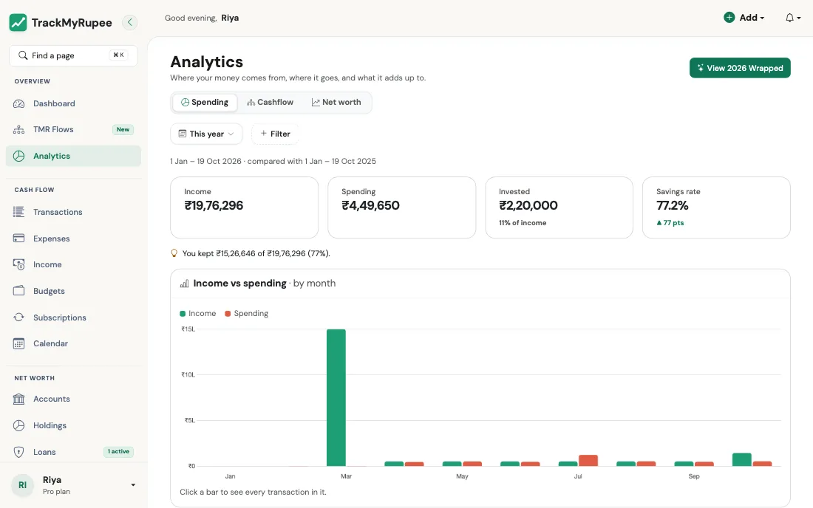
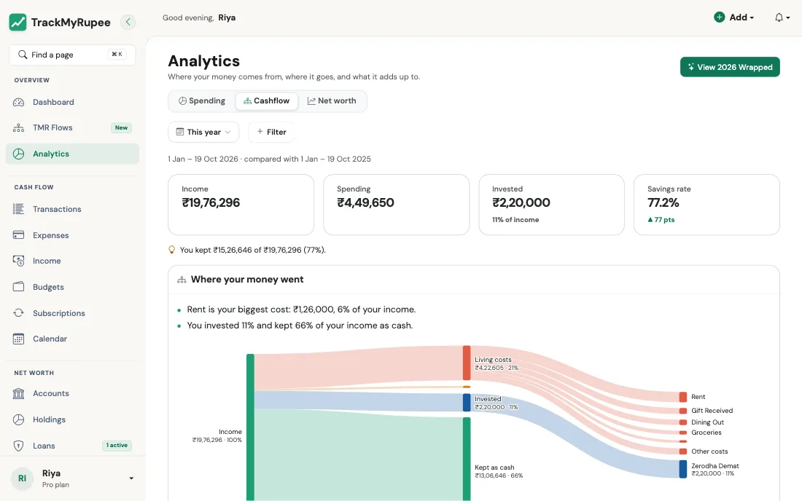
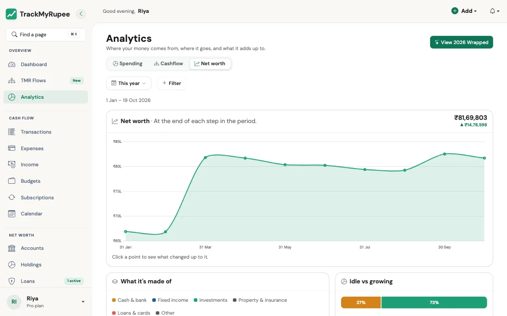

# Analytics: Spending, Cashflow and Net Worth

Understand your savings rate, where your money goes, and how your net worth moves, with summaries you can click through to the transactions behind them.

---

## 1. Opening Analytics

Navigate to **Sidebar → Analytics** on desktop, or go to **More → Analytics** on mobile (URL: `/analytics/`). The page has three tabs: **Spending**, **Cashflow** and **Net worth**. The tab you choose is kept when you change the period or a filter.

{ loading=lazy }

### Choose the period and filters

Analytics uses the same filter bar as Expenses, Income and Transactions:

- **Time period**: This month (or your salary cycle), Last month, Last 3 months, Last 6 months, This year, All time, or any **Custom range**. The page opens on **This year**.
- **+ Filter**: narrow by **Category** or **Account**, or switch on **Capital events** to count the one-off events you excluded from averages.

The charts adapt to the period you pick: one bar per **day** for up to 35 days, per **week** up to about 6 months, per **month** up to about 2 years, and per **quarter** beyond that.

A **category filter** narrows spending only. Income and savings stay as they are, and loan interest drops out, because it has no category.

### Comparisons

Every total is set against an earlier period, so you can see whether it is going up or down:

| You picked | It is compared with |
|---|---|
| This year | The same dates last year |
| This month (or cycle) | The same number of days of last month (or the cycle before) |
| Anything else | The stretch of the same length just before it |
| All time | Nothing |

If nothing was recorded in the comparison period, the comparison is left out instead of showing a flat line.

### Click any chart to see the transactions

Every tile, bar, row and block opens **All Transactions** for exactly the days and filters it shows. On a computer, a single click on a chart opens it and hovering shows the numbers. On a phone, tap a chart to see its numbers with a **View transactions** button, then tap the button.

---

## 2. The Spending Tab

- **Income vs spending**: a pair of bars per day, week, month or quarter. For short periods only spending is shown, because income arrives in lumps (a monthly salary) and would look like random spikes.
- **Where it went**: your categories, biggest first, with each one's share of spending and how it changed against the comparison. Each row opens that category's transactions.
- **Spending as it adds up**: your spending day by day, against the comparison period lined up by day. For **This month** a dotted line shows your budget spread evenly over the month.
- **Biggest categories over time** (tap to open): stacked bars for your top five categories, to spot one that is creeping up.

---

## 3. The Cashflow Tab

{ loading=lazy }

- **Where your money went**: a flow diagram. Your income splits into living costs, loan interest, investing and what you kept as cash. Living costs split into your biggest categories, and investing into the accounts the money went to. If you spent more than you earned, the difference shows as **Spent more than earned**. Click a block or a flow to see its transactions. A short list underneath gives the same numbers, and a few plain sentences say what stands out.
- **Health check**: four numbers instead of one score, each with what it measures:

| Number | What it measures |
|---|---|
| **Savings rate** | How much of your income you kept (green at 20% or more) |
| **Spending trend** | Your spending against the comparison period (green when it fell, amber up to +15%, red above that) |
| **Emergency fund** | Your cash and bank balances, in months of your average spending (green at 6 months or more) |
| **Months in the black** | How many months you spent less than you earned (needs at least two months of activity) |

- **This period against the one before**: spending per bar against the comparison period, bar for bar.

---

## 4. The Net Worth Tab

{ loading=lazy }

- **Net worth**: your net worth at the end of each step of the period, with how much it changed over the period. Each point is your balances as they stood that day (later transactions are taken back out), deposits accrued only up to then, holdings and property at their latest value on or before it, and loans at what was still owed. Click a point to see what changed up to it. The chart shows at most 12 points, evenly spaced.
- **What it's made of**: the same points split by account type: cash and bank, fixed income, investments, property and insurance, and what you owe on loans and cards (shown below the line). **Other** is money set aside for goals and loans that are not tied to an account.
- **Idle vs growing**: how the money you hold is spread between bank accounts and investments today. It counts accounts with a positive balance (deposits and holdings at their current value); credit cards, loans and overdrawn accounts are what you owe, so they are left out.
- **Categories creeping up**: categories whose monthly spending rose three complete months in a row. It always looks at the last three full months, whatever period you picked.

How far back you can look depends on your plan: **Free** shows the last 2 months, **Plus** 6, and **Pro** your whole history. Choosing a longer period shows an upgrade note instead of the older months.

---

## 5. How the Savings Rate Is Calculated

Every place in TrackMyRupee that shows a savings rate uses the same formula: the **Dashboard** headline, the **Analytics** tiles and Health check, the **Net Remaining** tile on the Transactions page, and the **monthly email report**. They can differ only because they look at different time periods or filters, never because they calculate it differently.

> **Savings** = Income − Expenses − Loan interest − Capital Events that count towards averages
>
> **Savings rate** = Savings ÷ (Income − Cashback and Refund income) × 100

A few rules sit behind that:

- **Loan principal is not spending.** When you pay an EMI, only the **interest** part counts as money spent. The principal part is you repaying money you borrowed, so it does not reduce your savings.
- **Capital Events count only if you chose so.** A Capital Event is left out by default (its **Exclude from Averages & Trends** setting is on), so one big purchase does not wreck the month. Turn that setting off on an event and it counts as spending. The **Capital events** filter on the Analytics page temporarily adds the excluded ones.
- **Cashback and Refunds are money in, but not part of the base.** Cashback and Rewards and Refund / Reimbursement income is added to your savings (the money really is yours), but it is left out of the amount your rate is measured against. Your rate is measured against what you *earned*, so a refund can only improve it, never dilute it.
- **No income, no rate.** If the base is zero or less, the rate shows 0 instead of a misleading number. Spending more than you earn gives a negative rate.
- **Everything is in your own currency.** Foreign amounts are converted when you save them.

!!! example "A worked example"
    In a month Ananya earns a Rs. 50,000 salary and gets Rs. 1,000 cashback. She spends Rs. 20,000 on regular expenses and pays an EMI of Rs. 8,000, of which Rs. 2,000 is interest.

    - Savings = 51,000 − 20,000 − 2,000 = **Rs. 29,000** (the Rs. 6,000 of principal is not counted)
    - Base = 51,000 − 1,000 = 50,000
    - Savings rate = 29,000 ÷ 50,000 = **58%**

---

## 6. Year in Review ("Wrapped")

On Plus and Pro, the **View <year> Wrapped** button on the Analytics page opens a story-style summary of the year your period ends in (URL: `/year-in-review/<year>/`): what you earned and spent, your top three categories, your highest and lowest spending months, your most-used payment method, your biggest single expense, how much you invested, and the goals you completed (a goal belongs to the year its last contribution was made). The current year counts up to today. Free accounts are shown the pricing page instead.

---

## 7. An Important Note on All Insights

The takeaways, the Health check and every chart on these pages are **descriptive summaries of your own historical data**. They show what has happened in your records.

They are not financial advice and they do not predict future outcomes. Use them as data-informed prompts for your own decision-making.

!!! example "Real-world use case"
    Nisha is considering applying for a personal loan and wants to understand her financial standing first. She opens Analytics and sets the period to **Last 6 months**. The Spending tab shows her savings rate at 6 percent, down from 14 percent in the six months before. On the Cashflow tab, Dining Out is her second biggest cost and it went up Rs. 9,000 against the earlier period, so she clicks it and sees every restaurant transaction behind the number. On the Net worth tab, **Idle vs growing** shows Rs. 1.8 lakh sitting in a Savings Account. She moves Rs. 80,000 into her Mutual Fund account with an Internal Transfer. Two months later her savings rate is 22 percent and her Emergency fund reads 4.5 months, giving her a cleaner picture before she approaches a lender.

---

## Related Links
- [Accounts and Net Worth](../02-accounts/index.md)
- [Budgets](../07-budgets/index.md)
- [Transfers](../06-transfers/index.md)
- [Philosophy](../00-philosophy.md)
