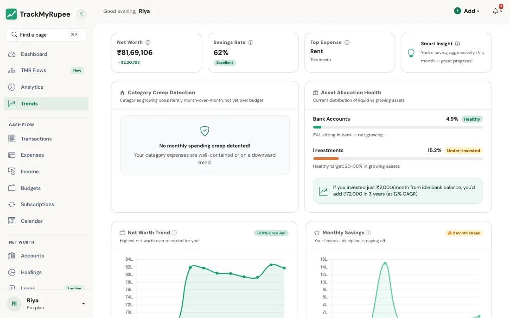

# Analytics, Trends and Financial Health

Understand your savings rate, spending patterns, and overall financial health with data-driven summaries.

---

## 1. Opening Analytics

Navigate to **Sidebar → Analytics** on desktop, or go to **More → Analytics** on mobile (URL: `/analytics/`).

{ loading=lazy }

---

## 2. Reading the Financial Health Score

The **Health Score** card at the top of the Analytics page shows a score from 0 to 100, worked out from the year's savings rate (see section 3):

| Score | Label | Savings rate |
|---|---|---|
| 10 | At Risk | Negative (spending more than you earn) |
| 40 | Caution | 0 to under 10 percent |
| 70 | Stable | 10 to under 30 percent |
| 95 | Wealth Builder | 30 percent or more |

With no data at all the rate is 0, so the card reads 40 / Caution.

Under the score, short **insights** say what the number means: how much you saved out of how much you earned (the same figures the rate is built from), how far you are from the 30 percent mark, whether one category takes more than 30 percent of your income, and whether your spending is running more than 15 percent above your 3-month average.

Expand the **Health Breakdown** section to see the four metrics behind it. Each has a green, amber or red icon:

| Metric | What it measures | Green | Amber | Red |
|---|---|---|---|---|
| **Savings Rate** | The year's savings rate | 20% or more | above 0% | 0% or less |
| **Expense Growth** | Your everyday spending per month this year (expenses plus loan interest, no capital events) compared with the average of the last 3 completed months | zero or falling | up to +15% | above +15% |
| **Consistency** | How many of the last 10 completed months had positive savings (and some income) | 7 or more | 4 to 6 | fewer than 4 |
| **Risk Buffer** | Months you could live on your savings: the year's savings divided by your average monthly spend over the last 3 completed months | 6 months or more | 3 to 6 | under 3 |

---

## 3. How the Savings Rate Is Calculated

Every place in TrackMyRupee that shows a savings rate uses the same formula: the **Dashboard** headline, the **Analytics** Health Score and monthly trend, **Month on Month**, the **Net Remaining** tile on the Transactions page, and the **monthly email report**. They can differ only because they look at different time periods or filters, never because they calculate it differently.

> **Savings** = Income − Expenses − Loan interest − Capital Events that count towards averages
>
> **Savings rate** = Savings ÷ (Income − Cashback and Refund income) × 100

A few rules sit behind that:

- **Loan principal is not spending.** When you pay an EMI, only the **interest** part counts as money spent. The principal part is you repaying money you borrowed, so it does not reduce your savings.
- **Capital Events count only if you chose so.** A Capital Event is left out by default (its **Exclude from Averages & Trends** setting is on), so one big purchase does not wreck the month. Turn that setting off on an event and it counts as spending. The **Include capital events** switch on the Analytics chart temporarily adds the excluded ones.
- **Cashback and Refunds are money in, but not part of the base.** Cashback and Rewards and Refund / Reimbursement income is added to your savings (the money really is yours), but it is left out of the amount your rate is measured against. Your rate is measured against what you *earned*, so a refund can only improve it, never dilute it.
- **No income, no rate.** If the base is zero or less, the rate shows 0 instead of a misleading number. Spending more than you earn gives a negative rate.
- **Everything is in your own currency.** Foreign amounts are converted when you save them.

!!! example "A worked example"
    In a month Ananya earns a Rs. 50,000 salary and gets Rs. 1,000 cashback. She spends Rs. 20,000 on regular expenses and pays an EMI of Rs. 8,000, of which Rs. 2,000 is interest.

    - Savings = 51,000 − 20,000 − 2,000 = **Rs. 29,000** (the Rs. 6,000 of principal is not counted)
    - Base = 51,000 − 1,000 = 50,000
    - Savings rate = 29,000 ÷ 50,000 = **58%**

---

## 4. Year-to-Date Totals and the Charts

Pick a year with the selector at the top. For the **current year** everything stops at **today**, so entries dated ahead (such as recurring ones posted in advance) are not counted yet. A **past year** is the whole year, January to December.

The tiles show:

- **Total Income**: all income for the period.
- **Total Expenses**: what you spent. This is the same "spending" the savings rate uses: expenses, plus the **interest** part of loan repayments, plus capital events that count. Loan principal is not spending. So **Income − Total Expenses = your savings**.
- **Total Invested**: transfers into your investment and deposit accounts (mutual funds, demat, NPS, FD, RD and similar), in your own currency.
- **Savings Rate**: the rate for the whole period.

The charts all use the same period and the same definitions:

- **Monthly income and expenses** with the month's savings rate as a line. The bars and the line reconcile: a month's rate is (income − the spending bar) ÷ income. The **Include capital events** switch temporarily adds the capital events you excluded from averages to the bars and the rate.
- **Category distribution** (expense entries only) and **spending by day of week**.
- **Where your money went** (flow diagram): income splits into savings, investments, loan interest, capital events and living expenses, with your five biggest categories listed under living expenses and the rest grouped as Other. A year in which you spent more than you earned shows the shortfall as "Deficit".
- **This month so far**: a running total against your category limits spread evenly over the month, with a projection at your current daily pace (current year only), and a split of this month's spending into recurring and one-time entries.

These are factual summaries of the data you have logged. They are not predictions or advice.

---

## 5. Reading the Trends Page

Navigate to **Sidebar → Trends** on desktop, or go to **More → Trends** on mobile (URL: `/analytics/mom/`).

{ loading=lazy }

The Trends page shows two key analyses:

- **Category Creep Detection**: Identifies categories where your spend has grown significantly compared to a previous period. This helps you spot gradual increases before they become a problem.
- **Asset Allocation Health**: Shows how your wealth is distributed across cash, fixed-income, and market-linked investments. A flag appears if too much wealth is sitting idle in low-yield accounts.

---

## 6. Year in Review ("Wrapped")

On Plus and Pro, the **View <year> Wrapped** button on the Analytics page opens a story-style summary of the selected year (URL: `/year-in-review/<year>/`): what you earned and spent, your top three categories, your highest and lowest spending months, your most-used payment method, your biggest single expense, how much you invested, and the goals you completed. The current year counts up to today. Free accounts are shown the pricing page instead.

---

## 7. An Important Note on All Insights

The Financial Health score, the insights panel, and all Trends analyses are **descriptive summaries of your own historical data**. They show what has happened in your records.

They are not financial advice and they do not predict future outcomes. Use them as data-informed prompts for your own decision-making.

!!! example "Real-world use case"
    Nisha is considering applying for a personal loan and wants to understand her financial standing first. She opens Analytics and checks her Health Score. It shows 40 (savings rate 6 percent, Caution). She then opens Trends and sees an over-idle flag: Rs. 1.8 lakh sitting in a Savings Account earning 3 percent per year. She transfers Rs. 80,000 into her Mutual Fund account via Add → Internal Transfer, which shifts her asset allocation. Two months later, with her savings rate up to 22 percent and the idle-cash flag cleared, her Health Score moves to 70 (Stable), giving her a cleaner financial picture before she approaches a lender.

---

## Related Links
- [Accounts and Net Worth](../02-accounts/index.md)
- [Budgets](../07-budgets/index.md)
- [Transfers](../06-transfers/index.md)
- [Philosophy](../00-philosophy.md)
