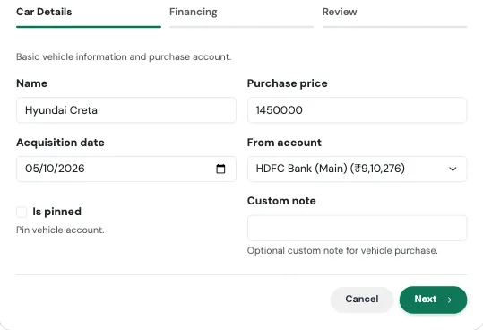
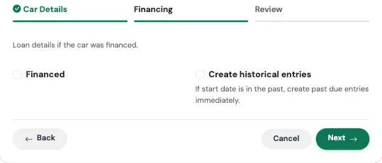
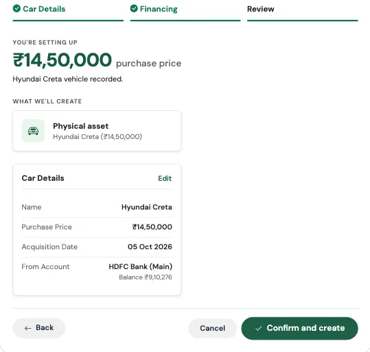
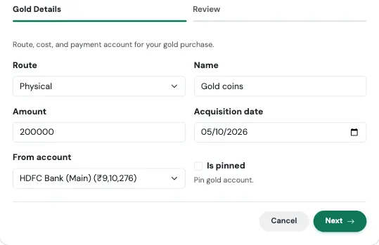
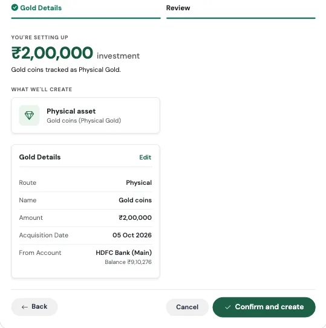

# एसेट्स फ्लो (Assets Flows)

कुछ खरीदारियां खर्च नहीं होतीं, वे **स्वामित्व** होती हैं। कार और सोना खरीदने के बाद भी पैसे की कीमत रखते हैं। **Assets** श्रेणी के दो Flow, **I bought a car** और **I bought gold**, यह पक्का करते हैं कि ये चीज़ें आपकी निवल संपत्ति में दिखें, न कि भुगतान करने के दिन ही आपकी तस्वीर से गायब हो जाएं।

---

## कार खरीदी (I Bought a Car) { #i-bought-a-car }

> *नकद हो या फाइनेंस, दोनों तरह से यह आपकी निवल संपत्ति में जुड़ती है।*

### इसे ऐसे समझें जैसे RTO में कार का रजिस्ट्रेशन

जब आप कार रजिस्टर कराते हैं, तो उसे एक नंबर और आपके नाम का आधिकारिक रिकॉर्ड मिलता है। अगर उसके पीछे बैंक का लोन है, तो वह भी उसी रिकॉर्ड में दर्ज होता है। यह Flow आपके लिए दोनों हिस्से बनाता है: कार, जो आपकी संपत्ति है, और लोन (अगर है), जो आपकी देनदारी है, दोनों आपस में जुड़े हुए।

### इसका उपयोग कब करें

जब भी आप वाहन खरीदें, चाहे नकद भुगतान किया हो या कार लोन लिया हो। इसमें लगभग दो मिनट लगते हैं।

### आपको क्या भरना है

**चरण 1: Car Details**

{ loading=lazy width="560" }

| फ़ील्ड | क्या दर्ज करें |
|---|---|
| **Name** | कार को आप जिस नाम से बुलाते हैं, जैसे "Hyundai i20"। |
| **Purchase price** | कार की कीमत। |
| **Acquisition date** | जिस दिन आपने कार खरीदी। |
| **From account** | ज़रूरी। वह खाता जिससे पैसा (या EMI) जाएगा। |
| **Is pinned** | वैकल्पिक। वाहन को आपके खातों में सबसे ऊपर पिन करता है। |
| **Custom note** | वैकल्पिक। खरीद एंट्री के डिफ़ॉल्ट नोट की जगह लेता है। |

**चरण 2: Financing**

{ loading=lazy width="560" }

| फ़ील्ड | क्या दर्ज करें |
|---|---|
| **Financed** | अगर कार के लिए लोन लिया है तो इसे चुनें। नकद खरीद के लिए इसे बंद रखें। |
| **Loan name** | लोन का नाम। खाली छोड़ने पर यह "आपकी कार का नाम Loan" बन जाता है। |
| **Annual rate** | फाइनेंस होने पर ज़रूरी। सालाना ब्याज दर। |
| **Tenure months** | फाइनेंस होने पर ज़रूरी। लोन की अवधि महीनों में। |
| **Loan start date** | डिफ़ॉल्ट रूप से खरीद की तारीख। |
| **Create historical entries** | अगर लोन पहले शुरू हुआ था और आप पुरानी EMI अभी जोड़ना चाहते हैं तो इसे चालू करें। |

**समीक्षा और पुष्टि**

आखिरी टैब सेव करने से पहले बताता है कि क्या-क्या बनेगा, और सबसे ऊपर मुख्य आंकड़ा दिखाता है। उसे जांचें, फिर **Confirm and create** दबाएं। किसी चरण पर वापस जाने के लिए किसी भी कार्ड पर **Edit** का उपयोग करें।

{ loading=lazy width="560" }

### क्या बनता है

यह एकमात्र Flow है जहां नतीजा इस पर निर्भर करता है कि आपने भुगतान कैसे किया।

**हमेशा:**

- **एसेट के रूप में कार**, उसकी खरीद कीमत और शुरुआती मूल्य के साथ
- एक **Vehicle account**, ताकि कार आपकी निवल संपत्ति में गिनी जाए

**अगर आपने नकद भुगतान किया (Financed बंद है):**

- आपके चुने खाते से पूरी कीमत का *Large Purchase* प्रकार का एक **Capital Event**। पैसा सच में आपके खाते से गया है, और यह उसे आपके मासिक खर्च को बिगाड़े बिना दर्ज करता है।

**अगर आपने फाइनेंस किया (Financed चालू है):**

- ब्याज दर के साथ एक **कार लोन**
- आपके चुने खाते से चुकाई जाने वाली एक **आवर्ती EMI**
- लोन से जुड़ा एक **Vehicle Loan account**

इस स्थिति में खरीद का कोई Capital Event **नहीं** बनता। लोन और वाहन मिलकर पूरी कहानी बता देते हैं, और दूसरी एंट्री उसी पैसे को दो बार गिन लेती।

!!! example "वास्तविक उदाहरण: फाइनेंस"
    सिद्धार्थ ₹9,00,000 की कार खरीदता है और पूरी रकम 9% पर 60 महीनों के लिए फाइनेंस करवाता है। वह **I bought a car** चलाता है, कीमत और तारीख भरता है, **Financed** चुनता है, और 9 व 60 भरता है।

    अब उसकी निवल संपत्ति में कार ₹9,00,000 की संपत्ति के रूप में और लोन ₹9,00,000 की देनदारी के रूप में दिखता है, इसलिए कार घर लाने के दिन निवल संपत्ति न अचानक बढ़ती है, न गिरती है। हर महीने लगभग ₹18,683 की EMI उसके चुने खाते से जाती है और उसके साथ लोन की बाकी राशि घटती जाती है।

!!! example "वास्तविक उदाहरण: नकद"
    रेखा हैचबैक के लिए अपनी बचत से ₹6,50,000 चुकाती है। वह यही Flow चलाती है और **Financed** बंद रखती है। उसका बचत खाता ₹6,50,000 घट जाता है, Capital Events में एक Large Purchase दिखता है, और कार ₹6,50,000 की संपत्ति के रूप में जुड़ जाती है। उसकी मासिक खर्च रिपोर्ट सामान्य ही दिखती है, क्योंकि कार "इस महीने का" खर्च नहीं है। यह सिर्फ इस बात का बदलाव है कि उसकी संपत्ति कहां रखी है।

### ध्यान रखें

!!! warning "यहां फाइनेंस का मतलब 100% फाइनेंस है"
    Flow मानता है कि फाइनेंस की हुई कार पूरी तरह लोन से कवर है। अगर आपने खुद डाउन पेमेंट दिया है, तो लोन को [I took a loan](debt.md#i-took-a-loan) से सेट करें (उसमें डाउन पेमेंट का विकल्प है), और वाहन को [खाते](../02-accounts/index.md) पेज पर एक खाते के रूप में जोड़ें। अगर आपके साथ ऐसा अक्सर होता है, तो TMR Flows पेज पर **Request a flow** का उपयोग करके हमें बताएं।

!!! note "कार उसी कीमत पर दर्ज रहती है जो आपने चुकाई"
    Flow कार को उसकी खरीद कीमत पर दर्ज करता है। कारों की कीमत समय के साथ घटती है, इसलिए सालों में आपकी निवल संपत्ति कार की असली बिक्री कीमत से थोड़ी ज़्यादा दिखेगी। संख्या पढ़ते समय इसे ध्यान में रखें।

---

## सोना खरीदा (I Bought Gold) { #i-bought-gold }

> *भौतिक गहने हों या डिजिटल/SGB, दोनों तरह से ट्रैक होता है।*

### इसे ऐसे समझें जैसे बैंक का लॉकर

चाहे बैंक लॉकर में रखे मां के गहने हों या डीमैट खाते में पड़ा Sovereign Gold Bond, वह सोना है, आपका है, और गिना जाता है। यह Flow उसे किसी भी रूप में एक ही तरह से आपकी तस्वीर में जोड़ देता है।

### इसका उपयोग कब करें

जब भी आप किसी भी रूप में सोना खरीदें। इसमें एक मिनट से भी कम समय लगता है।

### आपको क्या भरना है

{ loading=lazy width="560" }

| फ़ील्ड | क्या दर्ज करें |
|---|---|
| **Route** | गहनों, सिक्कों या बार के लिए **Physical**, या Sovereign Gold Bond और ऐसे ही डिजिटल सोने के लिए **Digital SGB**। |
| **Name** | इसका नाम, जैसे "Diwali necklace" या "SGB 2026 Series II"। |
| **Amount** | आपने कितना चुकाया। |
| **Acquisition date** | जिस दिन आपने इसे खरीदा। |
| **From account** | वह खाता जिससे आपने भुगतान किया। इसे केवल तभी खाली छोड़ें जब सोना पहले से आपके पास हो या विरासत में मिला हो। |
| **Is pinned** | वैकल्पिक। खाते को आपकी सूची में सबसे ऊपर पिन करता है। |

**समीक्षा और पुष्टि**

आखिरी टैब सेव करने से पहले बताता है कि क्या-क्या बनेगा, और सबसे ऊपर मुख्य आंकड़ा दिखाता है। उसे जांचें, फिर **Confirm and create** दबाएं। किसी चरण पर वापस जाने के लिए किसी भी कार्ड पर **Edit** का उपयोग करें।

{ loading=lazy width="560" }

### क्या बनता है

नतीजा इस पर निर्भर करता है कि आपने कौन-सा रूट चुना।

**Physical:**

- खरीद कीमत और शुरुआती मूल्य के साथ एक **गोल्ड एसेट**
- वह मूल्य रखने वाला एक **Gold account**
- आपकी लागत कीमत पर एक **गोल्ड होल्डिंग**

**Digital SGB:**

- एक **Sovereign Gold Bond account**
- आपकी लागत कीमत पर एक **होल्डिंग**

**दोनों में, अगर आपने From account चुना है:**

- *Investment Lump Sum* प्रकार का एक **Capital Event**, जो खरीद की तारीख पर उस खाते से रकम निकालता है। अगर आप From account खाली छोड़ते हैं, तो किसी भी खाते से कुछ नहीं कटता, जो सालों पहले खरीदा सोना जोड़ते समय काम आता है।

!!! example "वास्तविक उदाहरण"
    मेघना दिवाली से पहले अपने बचत खाते से ₹1,20,000 देकर सोने का हार खरीदती है। वह **I bought gold** चलाती है, Physical चुनती है, नाम "Diwali necklace" रखती है, और 120000, तारीख व अपना बचत खाता भरती है।

    उसका बचत खाता ₹1,20,000 घट जाता है, हार ₹1,20,000 की संपत्ति के रूप में दिखता है, और खरीद Capital Events में दर्ज होती है, इसलिए उसके Dashboard को देखकर ऐसा नहीं लगता कि उसने त्योहारी खरीदारी में ज़्यादा खर्च कर दिया।

    एक साल बाद वह अपने पिता के पुराने सिक्के जोड़ती है, जो उसे विरासत में मिले थे। इनके लिए वह Flow फिर चलाती है और **From account** खाली छोड़ देती है, क्योंकि उसने इनके लिए भुगतान नहीं किया, और उसकी निवल संपत्ति बस उतनी बढ़ जाती है जितना मूल्य वह दर्ज करती है।

### ध्यान रखें

!!! note "सोना उसी कीमत पर दर्ज रहता है जो आपने चुकाई"
    सोने के भाव रोज़ बदलते हैं, लेकिन Flow आपकी खरीद लागत दर्ज करता है और उसी को मूल्य मानता है। आपकी निवल संपत्ति सोने के बाजार भाव के साथ नहीं चलेगी। इसे ऐसे समझें कि सोना उसी दिन के भाव पर गिना जा रहा है जिस दिन आपने उसे खरीदा था।

---

## संबंधित लिंक
- [TMR Flows का अवलोकन](index.md)
- [Debt Flows](debt.md)
- [Capital Events](../09-capital-events/index.md)
- [होल्डिंग्स और म्यूचुअल फंड](../02-accounts/holdings.md)
- [खाते और निवल संपत्ति](../02-accounts/index.md)
