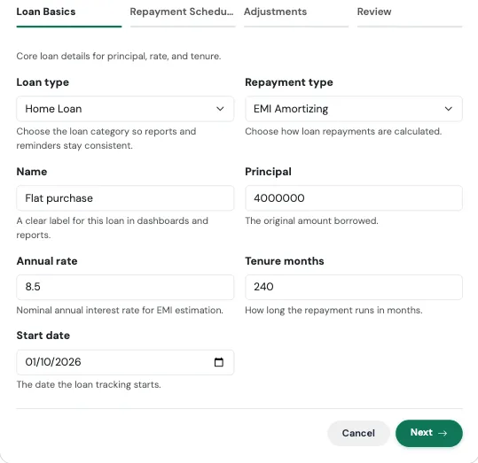
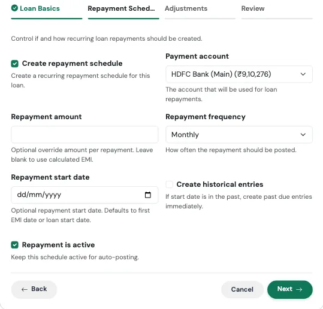
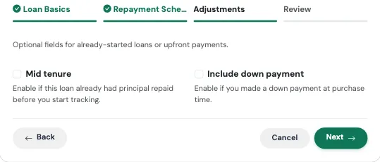
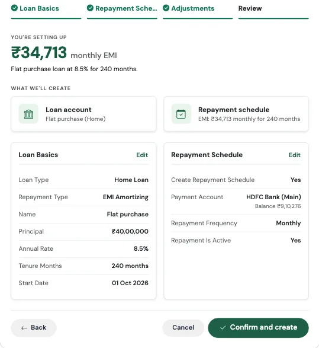
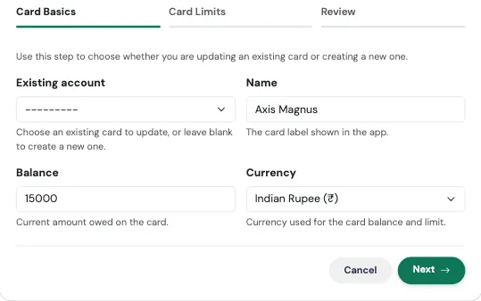
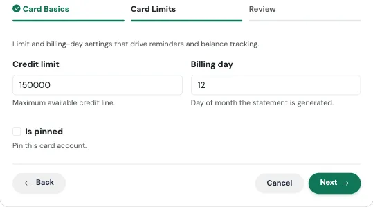
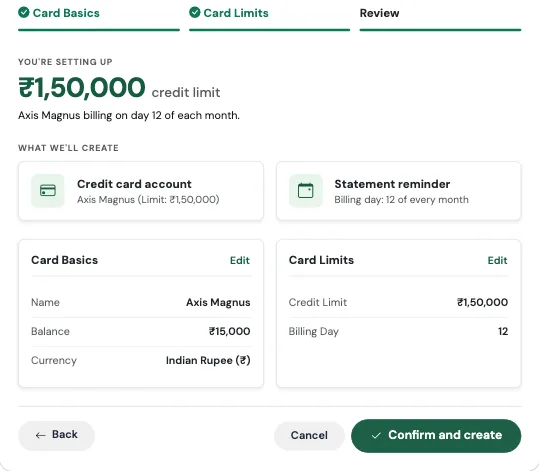

# कर्ज फ्लो (Debt Flows)

**Debt** श्रेणीत दोन Flow आहेत: **I took a loan** आणि **I got a credit card**.

---

## कर्ज घेतले (I Took a Loan) { #i-took-a-loan }

> *होम, कार किंवा पर्सनल. एकदा जोडा आणि EMI आपोआप ट्रॅक होतील.*

### याला रेल्वेच्या वेळापत्रकासारखे समजा

नवीन गाडी सुरू झाली की रेल्वे रोज स्टेशनवर कोणाला घोषणा करायला पाठवत नाही. वेळापत्रक एकदा छापले जाते आणि गाडी वेळेवर धावत राहते. हा Flow तुमच्या कर्जासाठी हेच करतो. तुम्ही कर्ज एकदा नोंदवता, आणि तुम्ही काहीही न करता प्रत्येक EMI तिच्या देय तारखेला दिसते.

### कधी वापरावे

तुमच्या आयुष्यात नवीन कर्ज आले की, मग ते होम लोन, पर्सनल लोन, एज्युकेशन लोन, बिझनेस लोन असो, किंवा हप्त्यांमध्ये फेडायचे कोणतेही कर्ज असो. यासाठी साधारण दोन मिनिटे लागतात.

### काय भरायचे

फॉर्ममध्ये तीन पायऱ्या आहेत.

**पायरी 1: Loan Basics**

{ loading=lazy width="560" }

| फील्ड | काय भरायचे |
|---|---|
| **Loan type** | Home, Car, Personal, Education, Business किंवा Other. यामुळे तुमचे अहवाल आणि रिमाइंडर व्यवस्थित राहतात. |
| **Repayment type** | **EMI Amortizing** (नेहमीचा प्रकार, जिथे दर महिन्याची रक्कम सारखी असते), **Bullet Repayment** (तुम्ही सर्व काही शेवटी फेडता), किंवा **Interest Only** (तुम्ही दर महिन्याला फक्त व्याज भरता आणि मुद्दल नंतर). |
| **Name** | तुम्हाला ओळखता येईल असे नाव, उदा. "HDFC Home Loan". |
| **Principal** | तुम्ही घेतलेली मूळ रक्कम. |
| **Annual rate** | वार्षिक व्याजदर, उदा. 8.5. |
| **Tenure months** | कर्ज किती महिने चालेल. 20 वर्षांचे कर्ज म्हणजे 240. |
| **Start date** | कर्ज सुरू होण्याची तारीख. |

**पायरी 2: Repayment Schedule**

{ loading=lazy width="560" }

| फील्ड | काय भरायचे |
|---|---|
| **Create repayment schedule** | डीफॉल्टनुसार चालू. यामुळेच EMI दर महिन्याला आपोआप नोंदली जाते. |
| **Payment account** | ज्या खात्यातून EMI भरली जाते ते खाते. |
| **Repayment amount** | हे रिकामे ठेवल्यास TrackMyRupee स्वतः काढलेली EMI वापरते. तुमच्या बँकेचा आकडा थोडा वेगळा असेल तरच हे भरा. |
| **Repayment frequency** | डीफॉल्टनुसार Monthly. |
| **Repayment start date** | पर्यायी. डीफॉल्टनुसार पहिल्या EMI ची तारीख, किंवा कर्जाची सुरुवातीची तारीख. |
| **Create historical entries** | कर्ज आधी सुरू झाले असेल आणि जुन्या EMI आत्ताच नोंदवायच्या असतील तर हे चालू करा. पहा [बॅकफिल स्विच](index.md#4-create-historical-entries-the-backfill-switch). |
| **Repayment is active** | हे चालू ठेवा, म्हणजे शेड्यूल नोंदले जात राहील. |

**पायरी 3: Adjustments** (दोन्ही भाग पर्यायी आहेत)

{ loading=lazy width="560" }

- **Mid tenure**: काही काळापूर्वी घेतलेल्या कर्जासाठी. तुम्ही मुद्दलाचा किती भाग आधीच फेडला आहे आणि तुमच्या पहिल्या EMI ची तारीख भरा. मग TrackMyRupee पहिल्या दिवसापासून नाही, तर तुम्ही प्रत्यक्षात जिथे आहात तिथून सुरू करते.
- **Include down payment**: खरेदीसाठी घेतलेल्या कर्जांसाठी. डाउन पेमेंटची रक्कम, ज्या खात्यातून ते दिले ते खाते (आवश्यक), आणि एक पर्यायी टीप भरा.

**आढावा आणि खात्री**

शेवटचा टॅब काहीही सेव्ह होण्यापूर्वी सर्व काही दाखवतो. वरचा मोठा आकडा म्हणजे तुमची मासिक EMI. तो तुमच्या बँकेच्या आकड्याशी पडताळून पहा, मग **Confirm and create** दाबा. काही चुकीचे वाटल्यास मागे जाण्यासाठी कोणत्याही कार्डवरील **Edit** लिंक वापरा.

{ loading=lazy width="560" }

### काय तयार होते

- तुमची शिल्लक आणि व्याजदरासह एक **कर्ज खाते**
- आवर्ती EMI म्हणून सेट केलेले एक **परतफेड शेड्यूल**
- तुम्ही डाउन पेमेंट जोडले असल्यास, कर्जाशी जोडलेला *Loan Down Payment* प्रकारचा एक **Capital Event**

आढावा स्क्रीनवर दिसणारा मोठा आकडा म्हणजे काढलेली तुमची मासिक EMI, जेणेकरून खात्री करण्यापूर्वी तुम्ही ती बँकेने सांगितलेल्या रकमेशी तपासू शकता.

!!! example "प्रत्यक्ष उदाहरण"
    रोहनने नुकताच फ्लॅट घेतला आहे. त्याने HDFC कडून 20 वर्षांसाठी 8.5% दराने ₹40,00,000 कर्ज घेतले, आणि ₹6,00,000 डाउन पेमेंट आपल्या बचत खात्यातून दिले.

    तो **TMR Flows** उघडतो, **I took a loan** निवडतो, **Home** आणि **EMI Amortizing** निवडतो, नाव "HDFC Home Loan" ठेवतो, आणि 4000000, 8.5 व 240 भरतो, सुरुवातीची तारीख 5 नोव्हेंबर. शेड्यूल पायरीवर तो पेमेंट खाते म्हणून आपले पगार खाते निवडतो. अॅडजस्टमेंट्स पायरीवर तो डाउन पेमेंट चालू करतो आणि 600000 भरतो.

    आढावा स्क्रीन ₹34,713 ची मासिक EMI दाखवते. ती त्याच्या बँकेच्या मंजुरी पत्राशी जुळते, म्हणून तो खात्री करतो. आता त्याच्या Loans पेजवर कर्ज दिसते, त्याची EMI दर महिन्याच्या 5 तारखेसाठी शेड्यूल झाली आहे, आणि डाउन पेमेंट Capital Events मध्ये आहे, त्यामुळे ते त्याचा मासिक खर्च कधीही बिघडवत नाही.

### लक्षात ठेवा

!!! warning "काही EMI आधीच भरल्या आहेत? Mid tenure वापरा"
    तुम्ही कर्ज दोन वर्षांपूर्वी घेतले असेल आणि ते आजच्या तारखेने व पूर्ण मुद्दलासह सुरू केले, तर तुमची उरलेली शिल्लक खूपच जास्त दिसेल. **Mid tenure** पर्याय वापरा आणि तुम्ही आधीच फेडलेले मुद्दल भरा.

!!! note "काही तपासण्या"
    तुम्ही आधीच फेडलेले मुद्दल कर्जाइतके किंवा त्यापेक्षा जास्त असल्यास फॉर्म असे कर्ज सेव्ह करू देणार नाही. काढलेली EMI शून्य आल्यास, जे 0% दरावर होऊ शकते, तो परतफेडीची रक्कमही मागेल.

!!! tip "नंतर दर बदलणे"
    फ्लोटिंग दराची कर्जे काळानुसार बदलतात. तुम्ही नंतर कर्जातूनच व्याजदर अपडेट करू शकता. पहा [कर्जे](../08-loans/index.md).

---

## क्रेडिट कार्ड मिळाले (I Got a Credit Card) { #i-got-a-credit-card }

> *शिल्लक, मर्यादा आणि बिलिंग सायकल, एकाच वेळी.*

### याला हॉटेलच्या मिनीबारच्या हिशेबासारखे समजा

तुम्ही आठवडाभर स्नॅक्स घेत राहता, रक्कम फक्त वाढत जाते, आणि चेकआउटच्या दिवशी तुम्ही हिशेब चुकता करता. क्रेडिट कार्डही असेच काम करते, आणि एक गोष्ट तुम्ही विसरू नये ती म्हणजे चेकआउटचा दिवस. हा Flow तुमचे कार्ड, तुमची देणी, तुमच्याकडे किती मर्यादा उरली आहे, आणि स्टेटमेंट तयार होण्याचा दिवस साठवतो, म्हणजे रिमाइंडर वेळेत तुमच्यापर्यंत पोहोचतो.

### कधी वापरावे

तुम्हाला नवीन कार्ड मिळाले की, किंवा तुम्ही अजून ट्रॅक न केलेले जुने कार्ड जोडायचे असेल तेव्हा. यासाठी साधारण एक मिनिट लागते.

### काय भरायचे

**पायरी 1: Card Basics**

{ loading=lazy width="560" }

| फील्ड | काय भरायचे |
|---|---|
| **Existing account** | पर्यायी. डुप्लिकेट तयार करण्याऐवजी अपडेट करण्यासाठी आधीच जोडलेले कार्ड निवडा. अगदी नवीन कार्डसाठी रिकामे ठेवा. |
| **Name** | अॅपमध्ये दिसणारे नाव, उदा. "ICICI Amazon Pay". |
| **Balance** | कार्डवर तुमची सध्याची **देणी** असलेली रक्कम. ती धन संख्या म्हणून भरा. नवीन कार्डसाठी शून्य चालेल. |
| **Currency** | डीफॉल्टनुसार तुमच्या प्रोफाइलचे चलन. |

**पायरी 2: Card Limits**

{ loading=lazy width="560" }

| फील्ड | काय भरायचे |
|---|---|
| **Credit limit** | तुमची बँक कार्डवर जास्तीत जास्त जितका खर्च करू देते ती रक्कम. |
| **Billing day** | महिन्याचा तो दिवस ज्या दिवशी तुमचे स्टेटमेंट तयार होते, 1 ते 31 मधील. |
| **Is pinned** | पर्यायी. कार्ड तुमच्या खात्यांच्या यादीत सर्वात वर पिन करते. |

**आढावा आणि खात्री**

शेवटचा टॅब काहीही सेव्ह होण्यापूर्वी काय तयार होणार ते सांगतो, आणि वरती मुख्य आकडा दाखवतो. तो तपासा, मग **Confirm and create** दाबा. कोणत्याही पायरीवर परत जाण्यासाठी कोणत्याही कार्डवरील **Edit** वापरा.

{ loading=lazy width="560" }

### काय तयार होते

- तुमच्या मर्यादेच्या तुलनेत देणी ट्रॅक करणारे एक **क्रेडिट कार्ड खाते**
- तुमच्या बिलिंग दिवसावर आधारित एक **बिलिंग सायकल**
- **प्रत्येक स्टेटमेंटच्या तीन दिवस आधी एक रिमाइंडर**, म्हणजे कोणतेही बिल तुम्हाला अचानक येत नाही

!!! example "प्रत्यक्ष उदाहरण"
    नेहाला ₹1,50,000 मर्यादेचे Axis Neo कार्ड मिळते. स्टेटमेंट दर महिन्याच्या 18 तारखेला तयार होते. पहिल्याच आठवड्यात तिने ₹32,000 खर्च केले आहेत.

    ती **I got a credit card** चालवते, नाव भरते, शिल्लक म्हणून 32000, मर्यादा म्हणून 150000 आणि बिलिंग दिवस म्हणून 18 भरते. आढावा स्क्रीन तिची ₹1,50,000 मर्यादा आणि "दर महिन्याच्या 18 तारखेला बिलिंग" दाखवते, त्यामुळे खात्री करण्यापूर्वी तिला तपशील बरोबर असल्याचे कळते. आता दर महिन्याच्या 15 तारखेला, स्टेटमेंट येण्याच्या तीन दिवस आधी, तिला रिमाइंडर मिळतो, आणि नेमकी तेव्हाच ती लवकर पैसे भरायचे का ते पाहते.

### लक्षात ठेवा

!!! warning "Balance म्हणजे तुम्हाला जे देणे आहे ते"
    तुम्हाला जी रक्कम द्यायची आहे ती धन संख्येत भरा, ऋण संख्येत नाही. TrackMyRupee ती तुमची देणी म्हणून नोंदवते, त्यामुळे ती आपोआप तुमची निव्वळ संपत्ती कमी करते.

!!! tip "हे कार्ड आधीच हाताने जोडले आहे?"
    ते **Existing account** मध्ये निवडा, म्हणजे Flow दुसरी प्रत तयार करण्याऐवजी मर्यादा आणि बिलिंग दिवस अपडेट करेल.

---

## संबंधित लिंक्स
- [TMR Flows चा आढावा](index.md)
- [कर्जे](../08-loans/index.md)
- [Capital Events](../09-capital-events/index.md)
- [खाती आणि निव्वळ संपत्ती](../02-accounts/index.md)
