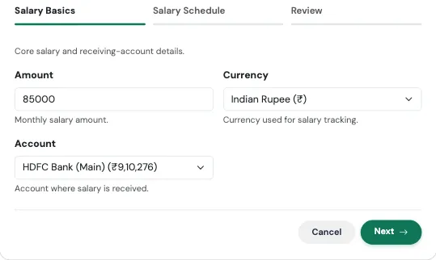
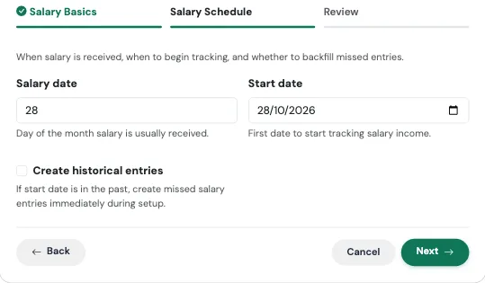
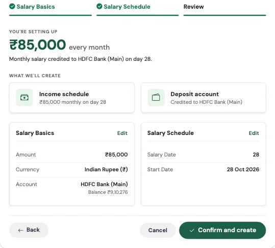
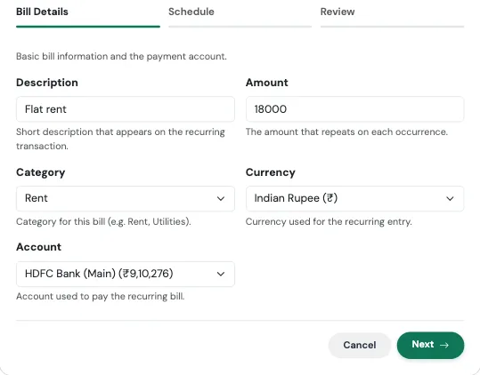
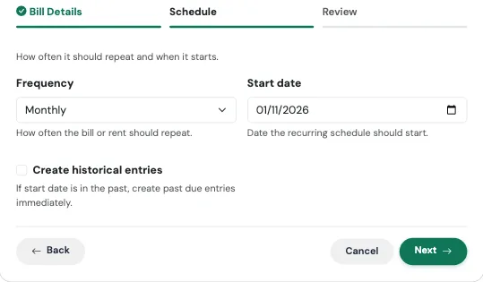
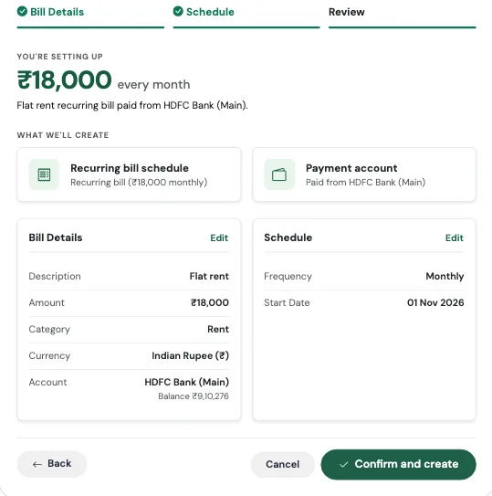
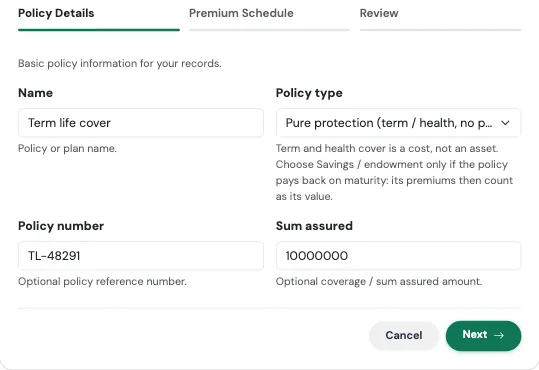
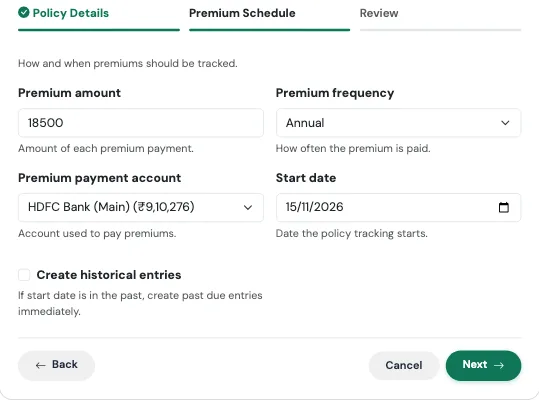
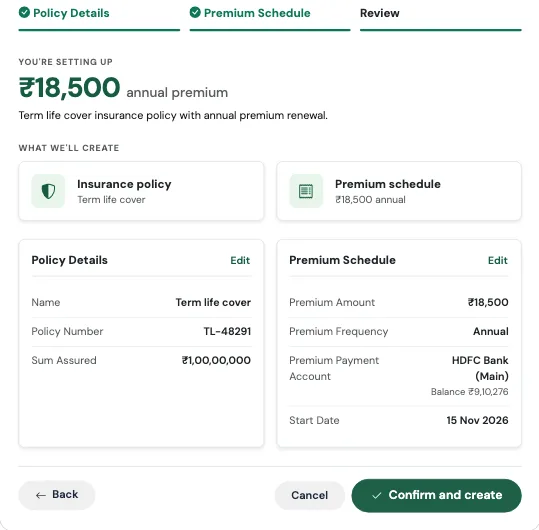

# उत्पन्न आणि बिले फ्लो (Income and Bills Flows)

तीन Flow येणाऱ्या पैशांना आणि ठरलेल्या वेळी जाणाऱ्या बिलांना सांभाळतात: **I started a new job**, **I pay rent** आणि **I bought insurance**.

---

## नवीन नोकरी सुरू केली (I Started a New Job) { #i-started-a-new-job }

> *पगार, पगाराचा दिवस आणि तुमच्या मासिक व्ह्यूसाठी सॅलरी सायकल.*

### याला पगाराच्या दिवसाचा अलार्म लावण्यासारखे समजा

तुमच्या फोनच्या अलार्मला तारखेशी काही देणेघेणे नसते. त्याला फक्त तुम्हाला कधी उठायचे आहे ती वेळ हवी असते. तसेच TrackMyRupee ला तुमचा पगार येण्याचा दिवस माहीत असावा लागतो, म्हणजे ते "तुमच्या महिन्या"च्या सीमा योग्य ठिकाणी आखू शकते. तुमचा महिना कदाचित 1 ते 31 तारखेपर्यंत चालत नाही. तो पगाराच्या दिवसापासून पुढच्या पगाराच्या दिवसाच्या आदल्या दिवसापर्यंत चालतो.

### कधी वापरावे

तुम्ही नवीन नोकरी सुरू करता, नोकरी बदलता, किंवा अॅपला तुमचा पगाराचा दिवस कधीच सांगितलेला नसतो तेव्हा. यासाठी साधारण एक मिनिट लागते.

### काय भरायचे

**पायरी 1: Salary Basics**

{ loading=lazy width="560" }

| फील्ड | काय भरायचे |
|---|---|
| **Amount** | तुमचा मासिक पगार, म्हणजे प्रत्यक्षात तुमच्या खात्यात येणारी रक्कम. |
| **Currency** | डीफॉल्टनुसार तुमच्या प्रोफाइलचे चलन. |
| **Account** | ज्या खात्यात तुमचा पगार जमा होतो ते खाते. |

**पायरी 2: Salary Schedule**

{ loading=lazy width="560" }

| फील्ड | काय भरायचे |
|---|---|
| **Salary date** | महिन्याचा तो दिवस ज्या दिवशी तुमचा पगार साधारणपणे येतो, उदा. 28. |
| **Start date** | ज्या तारखेपासून पगार ट्रॅक करायचा ती पहिली तारीख. Flow ती त्या तारखेला किंवा त्यानंतरच्या तुमच्या पहिल्या खऱ्या पगाराच्या दिवसापर्यंत पुढे नेतो. म्हणजे सुरुवातीची तारीख 1 ऑक्टोबर आणि पगाराचा दिवस 28 असेल, तर तुमची पहिली पगाराची नोंद 28 ऑक्टोबरला होईल. |
| **Create historical entries** | तुमची सुरुवातीची तारीख भूतकाळातील असेल आणि चुकलेले महिने आत्ताच जोडायचे असतील तर हे चालू करा. पहा [बॅकफिल स्विच](index.md#4-create-historical-entries-the-backfill-switch). |

**आढावा आणि खात्री**

शेवटचा टॅब काहीही सेव्ह होण्यापूर्वी काय तयार होणार ते सांगतो, आणि वरती मुख्य आकडा दाखवतो. तो तपासा, मग **Confirm and create** दाबा. कोणत्याही पायरीवर परत जाण्यासाठी कोणत्याही कार्डवरील **Edit** वापरा.

{ loading=lazy width="560" }

### काय तयार होते

- दर महिन्याला पुन्हा येणारी, Salary म्हणून लेबल केलेली एक **आवर्ती उत्पन्न नोंद**
- तुमच्या प्रोफाइलवर **सेव्ह केलेला पगाराचा दिवस**
- एक अपडेट केलेला **मंथ-सायकल व्ह्यू**, म्हणजे Dashboard, Budgets आणि Analytics हे सर्व "या महिन्या"ला पगाराच्या दिवसापासून पगाराच्या दिवसापर्यंत मोजतात

हीच सॅलरी सायकल [सुरुवात करणे](../01-getting-started/index.md) मध्ये वर्णन केली आहे. Flow उत्पन्न सेट करतानाच ती तुमच्यासाठी सेट करतो, त्यामुळे दोघांमध्ये कधीही मतभेद होऊ शकत नाही.

!!! example "प्रत्यक्ष उदाहरण"
    इम्रान 1 ऑक्टोबरला नवीन कंपनीत रुजू होतो. त्याचा ₹85,000 पगार दर महिन्याच्या 28 तारखेला त्याच्या HDFC Salary Account मध्ये येतो.

    तो 10 ऑक्टोबरला **I started a new job** चालवतो, 85000 भरतो, HDFC Salary Account निवडतो, पगाराचा दिवस 28 आणि सुरुवातीची तारीख 1 ऑक्टोबर ठेवतो. Flow त्याची पहिली पगाराची नोंद पहिल्या 28 तारखेशी, म्हणजे 28 ऑक्टोबरशी जुळवतो. लगेचच Dashboard "01 Oct to 31 Oct" म्हणणे थांबवून "28 Sep to 27 Oct" म्हणू लागतो. आता त्याचे बजेट पगाराच्या दिवशी रीसेट होते, म्हणजे ज्या दिवशी त्याच्याकडे खरोखर नवीन पैसे असतात, 1 तारखेला नाही, जेव्हा तो अजून मागच्या महिन्याच्या पगारावर चालत असतो.

### लक्षात ठेवा

!!! tip "हे नंतर कुठे बदलायचे"
    पगाराचा दिवस तुमच्या प्रोफाइल सेटिंग्जमध्ये असतो. पगाराची रक्कम तुमच्या इतर आवर्ती नोंदींसोबत [सबस्क्रिप्शन](../05-transactions-recurring/index.md) मध्ये असते. पगारवाढ झाल्यावर तिथली आवर्ती पगाराची नोंद एडिट करा.

!!! warning "तुम्हाला प्रत्यक्षात मिळणारी रक्कमच भरा"
    तुमचा टेक-होम पगार भरा, CTC नाही. तुमचा बचत दर तुमच्या बँकेत पोहोचणाऱ्या रकमेवरून काढला जातो, त्यामुळे CTC भरल्यास तुमची बचत प्रत्यक्षापेक्षा चांगली दिसेल.

---

## भाडे भरतो/भरते (I Pay Rent) { #i-pay-rent }

> *देय तारीख आणि रिमाइंडरसह एक आवर्ती बिल.*

### याला दूधवाल्याला दिलेल्या कायमच्या सूचनेसारखे समजा

तुम्ही त्याला एकदा सांगता: "रोज सकाळी एक लिटर." त्यानंतर तुम्हाला आठवो वा न आठवो, तो येतो, आणि महिन्याच्या शेवटी खर्च शांतपणे तुमच्या हिशेबात जमा होतो. आवर्ती बिल अगदी असेच काम करते, फक्त यावेळी डिलिव्हरी म्हणजे एक रिमाइंडर आणि तुमच्या खर्चात आपोआप होणारी एक नोंद.

नाव काहीही असले तरी हा Flow फक्त भाड्यासाठी नाही. तो **पुन्हा पुन्हा येणाऱ्या कोणत्याही बिलासाठी** चालतो: सोसायटी मेंटेनन्स, ब्रॉडबँड, वीज, ट्यूशन फी, मोलकरणीचा पगार.

### कधी वापरावे

तुमच्याकडे ठरलेली रक्कम आणि ठरलेली तारीख असलेले बिल असते तेव्हा. यासाठी साधारण एक मिनिट लागते.

### काय भरायचे

**पायरी 1: Bill Details**

{ loading=lazy width="560" }

| फील्ड | काय भरायचे |
|---|---|
| **Description** | बिल कशाचे आहे, उदा. "Flat rent" किंवा "Airtel broadband". |
| **Amount** | प्रत्येक वेळी पुन्हा येणारी रक्कम. |
| **Category** | उदाहरणार्थ Rent किंवा Utilities. रिकामे ठेवल्यास ते Rent मध्ये नोंदले जाते. |
| **Currency** | डीफॉल्टनुसार तुमच्या प्रोफाइलचे चलन. |
| **Account** | ज्या खात्यातून बिल भरले जाते ते खाते. |

**पायरी 2: Schedule**

{ loading=lazy width="560" }

| फील्ड | काय भरायचे |
|---|---|
| **Frequency** | Daily, Weekly, Bi-Weekly, Monthly, Quarterly, Semi-Annually किंवा Yearly. |
| **Start date** | पहिल्या (किंवा पुढच्या) पेमेंटची तारीख. |
| **Create historical entries** | सुरुवातीची तारीख भूतकाळातील असेल आणि जुने पेमेंट जोडायचे असतील तर हे चालू करा. |

**आढावा आणि खात्री**

शेवटचा टॅब काहीही सेव्ह होण्यापूर्वी काय तयार होणार ते सांगतो, आणि वरती मुख्य आकडा दाखवतो. तो तपासा, मग **Confirm and create** दाबा. कोणत्याही पायरीवर परत जाण्यासाठी कोणत्याही कार्डवरील **Edit** वापरा.

{ loading=lazy width="560" }

### काय तयार होते

- प्रत्येक देय तारखेला आपोआप नोंदली जाणारी एक **आवर्ती खर्च नोंद**
- एक **देय तारखेचा रिमाइंडर**, म्हणजे देय होण्यापूर्वीच तुम्हाला कळते

!!! example "प्रत्यक्ष उदाहरण"
    सुरेश दर महिन्याच्या 1 तारखेला आपल्या बचत खात्यातून UPI ने ₹22,000 भाडे भरतो. तो **I pay rent** चालवतो, वर्णनात "Flat rent" लिहितो, 22000 भरतो, Monthly आणि सुरुवातीची तारीख 1 नोव्हेंबर निवडतो.

    आतापासून दर महिन्याच्या 1 तारखेला ₹22,000 एकही टॅप न करता त्याच्या Housing खर्चात नोंदले जातात, आणि त्याचे Budgets पेज दाखवते की भाडे आधीच हिशेबात आहे. तो ₹1,800 च्या ब्रॉडबँडसाठी वेगळे वर्णन निवडून हाच Flow पुन्हा चालवतो, आणि पाच मिनिटांत त्याच्या ठरलेल्या खर्चांचा पूर्ण नकाशा तयार होतो.

### लक्षात ठेवा

!!! tip "दर वर्षी बदलणारे भाडे"
    घरमालकाने भाडे वाढवले की Flow पुन्हा चालवू नका. [सबस्क्रिप्शन](../05-transactions-recurring/index.md) मधील आधीचे बिल उघडा आणि रक्कम एडिट करा. असे केल्याने तुमचा इतिहास एकाच ठिकाणी राहतो.

---

## विमा खरेदी केला (I Bought Insurance) { #i-bought-insurance }

> *पॉलिसीचा तपशील आणि आपोआप नूतनीकरण होणारा प्रीमियम.*

### याला सीट बेल्टच्या आठवणीसारखे समजा

तुम्ही त्याचा रोज विचार करत नाही, पण गरज पडते तेव्हा ते होते याचा आनंद वाटतो. विमा प्रीमियमचीही हीच अडचण आहे: ते विसरणे सोपे असते, आणि बंद पडलेली पॉलिसी खूप त्रासदायक ठरते. हा Flow पॉलिसी एकदा नोंदवतो आणि प्रीमियम शेड्यूलवर ठेवतो, म्हणजे ती शांतपणे कधीच बंद पडत नाही.

### कधी वापरावे

टर्म लाइफ, हेल्थ किंवा वारंवार प्रीमियम भरावा लागणाऱ्या कोणत्याही पॉलिसीसाठी. यासाठी साधारण एक मिनिट लागते.

### काय भरायचे

**पायरी 1: Policy Details**

{ loading=lazy width="560" }

| फील्ड | काय भरायचे |
|---|---|
| **Name** | पॉलिसी किंवा प्लानचे नाव, उदा. "HDFC Click 2 Protect". |
| **Policy type** | **Pure protection** (टर्म, हेल्थ) हा डीफॉल्ट आहे: निव्वळ संपत्तीत त्याचे मूल्य शून्य असते आणि त्याचे प्रीमियम हा खर्च असतो. पॉलिसी मुदतपूर्तीला पैसे परत देत असेल तरच **Savings / endowment** निवडा: तेव्हा भरलेले प्रीमियम हेच तिचे मूल्य मानले जाते. |
| **Policy number** | पर्यायी, पण एका ठिकाणी असणे उपयोगी पडते. |
| **Sum assured** | पर्यायी. कव्हरेजची रक्कम. |

**पायरी 2: Premium Schedule**

{ loading=lazy width="560" }

| फील्ड | काय भरायचे |
|---|---|
| **Premium amount** | तुम्ही प्रत्येक वेळी भरता ती रक्कम. |
| **Premium frequency** | Annual, Semi-Annual, Quarterly किंवा Monthly. |
| **Premium payment account** | ज्या खात्यातून प्रीमियम भरला जातो ते खाते. |
| **Start date** | ज्या तारखेपासून पॉलिसीचे ट्रॅकिंग सुरू होते ती तारीख. |
| **Create historical entries** | पॉलिसी आधी सुरू झाली असेल तर जुने प्रीमियम जोडण्यासाठी हे चालू करा. |

**आढावा आणि खात्री**

शेवटचा टॅब काहीही सेव्ह होण्यापूर्वी काय तयार होणार ते सांगतो, आणि वरती मुख्य आकडा दाखवतो. तो तपासा, मग **Confirm and create** दाबा. कोणत्याही पायरीवर परत जाण्यासाठी कोणत्याही कार्डवरील **Edit** वापरा.

{ loading=lazy width="560" }

### काय तयार होते

- तुमचा पॉलिसी क्रमांक, प्रीमियम आणि विमा रकमेसह एक **पॉलिसी रेकॉर्ड**
- एक जोडलेले **विमा खाते**, म्हणजे पॉलिसी तुमच्या इतर खात्यांसोबत दिसते
- तुम्ही निवडलेल्या कालावधीनुसार एक **आवर्ती प्रीमियम पेमेंट**

आढावा स्क्रीन सर्वात आधी तुमचा प्रीमियम तुम्ही निवडलेल्या कालावधीत दाखवते, उदा. *₹18,500 annual premium*, म्हणजे खात्री करण्यापूर्वी तुम्ही तो तुमच्या पॉलिसी दस्तऐवजाशी पडताळू शकता.

!!! example "प्रत्यक्ष उदाहरण"
    प्रिया ₹1 कोटीच्या कव्हरचा टर्म प्लान घेते. प्रीमियम वर्षाला ₹18,500 आहे, दर मार्चमध्ये देय, तिच्या बचत खात्यातून भरला जातो.

    ती पॉलिसीचे नाव आणि क्रमांक भरते, विमा रक्कम म्हणून 10000000 जोडते, Annual निवडते, आणि सुरुवातीची तारीख 3 मार्च निवडते. आता प्रीमियम दर मार्चमध्ये आपोआप नोंदला जातो. दोन वर्षांनी एखादा सहकारी तिला तिचा पॉलिसी क्रमांक विचारतो तेव्हा तिला ईमेलमध्ये शोधावे लागत नाही. तो तिच्या खात्यांमध्येच ठेवलेला आहे.

### लक्षात ठेवा

!!! warning "मासिक प्रीमियम जमत जातात"
    महिन्याला ₹1,500 चा प्रीमियम लहान वाटतो, पण तो वर्षाला ₹18,000 होतो. दोन प्लानची तुलना करताना मासिकाला 12 ने गुणा, म्हणजे तुम्ही सारख्या गोष्टींची तुलना कराल.

---

## संबंधित लिंक्स
- [TMR Flows चा आढावा](index.md)
- [सुरुवात करणे](../01-getting-started/index.md)
- [आवर्ती आणि सबस्क्रिप्शन](../05-transactions-recurring/index.md)
- [बजेट](../07-budgets/index.md)
