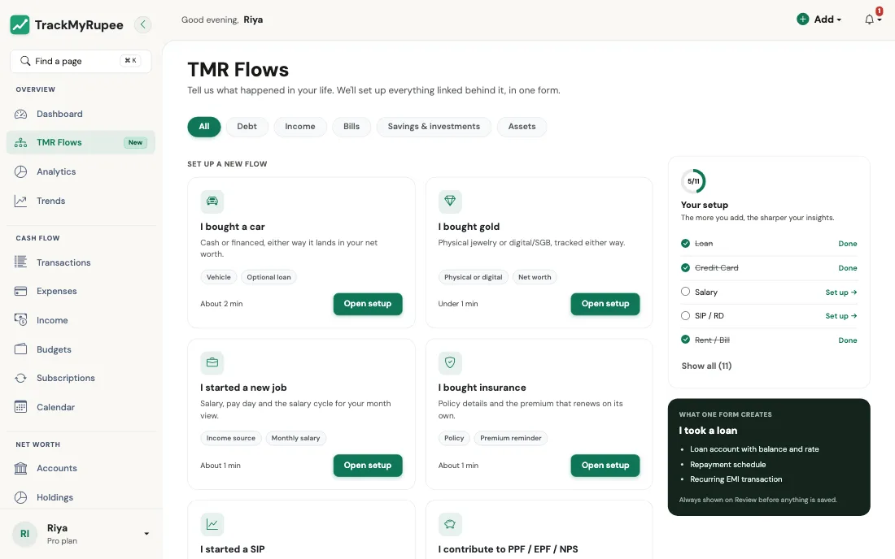

# TMR Flows

तुमच्या आयुष्यात काय घडले ते TrackMyRupee ला सांगा, आणि तो त्याच्याशी जोडलेले सर्व काही एकाच वेळी सेट करतो.

---

## 1. Flow म्हणजे काय

नवीन फ्लॅटमध्ये राहायला गेल्यावर काय होते ते आठवा. तुम्ही वीज मंडळाला, मग गॅस एजन्सीला, मग Wi-Fi कंपनीला, मग बँकेला एकेक करून, प्रत्येकाकडे वेगळा फॉर्म घेऊन जात नाही. तुम्ही एका मदतगार एजंटला सांगता "मी राहायला आलो", आणि ते सगळे एकत्र अपडेट होते.

**TMR Flow** अगदी असेच काम करतो. Flows नसते तर, तुम्ही कार लोन घेतल्यावर तुम्हाला हे करावे लागले असते:

1. एक लोन रेकॉर्ड तयार करणे.
2. व्याजदर जोडणे.
3. आवर्ती EMI सेट करणे.
4. डाउन पेमेंट कॅपिटल इव्हेंट म्हणून नोंदवणे.
5. कार मालमत्ता म्हणून जोडणे.

**I bought a car** Flow वापरल्यास, तुम्ही एक छोटा फॉर्म भरता आणि या पाचही गोष्टी तुमच्यासाठी तयार होतात, एकमेकांशी व्यवस्थित जोडलेल्या.

आज 11 Flows आहेत, जे पाच श्रेणींमध्ये विभागलेले आहेत:

| श्रेणी | Flows |
|---|---|
| [कर्ज](debt.mr.md) | I took a loan, I got a credit card |
| [उत्पन्न आणि बिले](income-and-bills.mr.md) | I started a new job, I pay rent, I bought insurance |
| [बचत आणि गुंतवणूक](savings-and-investments.mr.md) | I started a SIP, I booked an FD, I contribute to PPF / EPF / NPS, I'm saving for something |
| [मालमत्ता](assets.mr.md) | I bought a car, I bought gold |

---

## 2. TMR Flows उघडणे

डेस्कटॉपवर साइडबारमधील **TMR Flows** वर क्लिक करा. सध्या त्यावर एक छोटा **New** बॅज आहे.

{ loading=lazy }

पेजची सुरुवात या ओळीने होते: *"Tell us what happened in your life. We'll set up everything linked behind it, in one form."* त्याखाली तुम्हाला हे दिसेल:

- **Category tabs**: वरच्या बाजूला, All, Debt, Income, Bills, Savings & investments आणि Assets. यादी लहान करण्यासाठी एखाद्यावर टॅप करा.
- **Set up a new flow**: तुम्ही अजून वापरलेले नसलेले Flows. प्रत्येक कार्डावर एका ओळीचे वर्णन, काही टॅग आणि लागणाऱ्या वेळाचा अंदाजे आकडा असतो, उदा. "About 1 min".
- **Already set up**: तुम्ही आधीच पूर्ण केले आहेत असे TrackMyRupee ला दिसणारे Flows. यातील प्रत्येकावर **Edit existing** लिंक असते, जी तुम्हाला बदल करण्यासाठी योग्य पेजवर घेऊन जाते (उदाहरणार्थ, Loan Flow साठी तुमची लोन यादी, किंवा क्रेडिट कार्डसाठी तुमचे खाती पेज).
- **Your setup**: एक छोटा प्रगती पॅनेल, ज्यात 3/11 सारखी संख्या आणि मुख्य Flows ची चेकलिस्ट (Loan, Credit Card, Salary, SIP / RD आणि Rent / Bill) असते. ही परीक्षा नाही. तुमच्या पैशांच्या कोणत्या भागांची ॲपला आधीच माहिती आहे ते पाहण्याचा हा फक्त एक झटपट मार्ग आहे.
- **What one form creates**: निवडलेला Flow काय काय तयार करेल ते सांगणारा प्रीव्ह्यू पॅनेल, म्हणजे कोणतेही आश्चर्य नाही.
- **Request a flow**: तुमची परिस्थिती यादीत नसेल, तर आम्हाला सांगा आणि आम्ही तो तयार करू.

!!! tip "कुठून सुरुवात करायची कळत नाही?"
    बहुतेक लोकांना या क्रमाने सर्वोत्तम निकाल मिळतो: **I started a new job** (म्हणजे तुमचा महिना योग्य मोजला जातो), मग **I pay rent**, मग **I took a loan** किंवा **I got a credit card**, लागू असल्यास. या चार नंतर तुमचा Dashboard समजू लागतो.

---

## 3. Flow कसा चालतो

प्रत्येक Flow त्याच तीन पायऱ्यांनी चालतो.

### पायरी 1: तपशील भरा

फॉर्म लहान पायऱ्यांमध्ये विभागलेला असतो, ज्यावर **Step 1 of 2** सारखे प्रगती लेबल असते. प्रत्येक फील्डखाली सोप्या भाषेत मदतीची एक ओळ असते. पर्यायी म्हणून चिन्हांकित फील्ड वगळता येतात.

### पायरी 2: आढावा (Review)

काहीही सेव्ह होण्यापूर्वी, तुम्ही एका **Review** स्क्रीनवर पोहोचता. ती हे दाखवते:

- **You're setting up**: सोप्या शब्दांत एका ओळीचा सारांश, उदा. *"₹5,000 every month. SIP into Nifty 50 Index Fund from HDFC Salary, starting 15 Oct 2026."*
- **What we'll create**: कार्डांची एक छोटी यादी, तुमच्या खात्यात जोडल्या जाणाऱ्या प्रत्येक गोष्टीसाठी एक.
- **Your answers**: तुम्ही जे काही भरले ते, प्रत्येक भागासह **Edit** लिंक, म्हणजे चूक सुधारण्यासाठी पुन्हा पहिल्यापासून सुरू करावे लागत नाही.
- **Warnings**, असल्यास. सर्वात सामान्य म्हणजे प्लॅनची मर्यादा (खाली पहा).

### पायरी 3: खात्री करा

**Confirm and create** दाबा. तुम्ही यशस्वी संदेशासह Dashboard वर पोहोचता, आणि सर्व काही जागेवर असते. हे बटण दाबेपर्यंत काहीही तयार होत नाही, त्यामुळे तुम्ही निश्चिंतपणे **Back** किंवा **Cancel** दाबू शकता.

!!! example "रेस्टॉरंटच्या बिलासारखे समजा"
    Review स्क्रीन म्हणजे पैसे देण्यापूर्वी टेबलावर येणारे तपशीलवार बिल. तुम्ही प्रत्येक आयटम पाहू शकता, काही चुकीचे वाटले तर विचारू शकता, आणि त्यानंतरच कार्ड देता.

---

## 4. "Create Historical Entries": जुन्या नोंदी भरणारा स्विच { #4-create-historical-entries-the-backfill-switch }
अनेक Flows मध्ये **Create historical entries** नावाचा चेकबॉक्स असतो. तुमची सुरुवातीची तारीख मागे गेली असेल तेव्हाच तो महत्त्वाचा ठरतो, म्हणून एकदा तो समजून घेणे फायद्याचे आहे.

- **Off (डिफॉल्ट)**: TrackMyRupee नव्याने सुरुवात करतो. तो भूतकाळाला हात लावत नाही. वेळापत्रक पुढच्या येणाऱ्या देय तारखेपासून सुरू होते.
- **On**: TrackMyRupee तुमची सुरुवातीची तारीख आणि आज यांच्यातील प्रत्येक चुकलेली नोंद लगेच टाकतो, म्हणजे तुमचा इतिहास पूर्ण राहतो.

!!! example "प्रत्यक्ष वापराचे उदाहरण"
    काव्याने 1 जुलैला नोकरी सुरू केली आणि 12 ऑक्टोबरला salary Flow सेट करते. तिने बॉक्स **off** ठेवला, तर तिचा Dashboard पगार फक्त पुढच्या पगाराच्या तारखेपासून दाखवतो, आणि जुलै, ऑगस्ट व सप्टेंबर रिकामे दिसतात. तिने तो **on** केला, तर तीन महिन्यांच्या पगाराच्या नोंदी लगेच दिसतात आणि त्या महिन्यांचा तिचा बचत दर बरोबर येतो.

    जिमच्या सदस्यत्वासारख्या गोष्टीसाठी उलटे असते, जी ती आता ट्रॅक करू इच्छित नाही. त्यासाठी ती बॉक्स बंद ठेवते, कारण जुन्या नोंदींनी तिचे रिपोर्ट भरून जावेत असे तिला वाटत नाही.

---

## 5. प्लॅनच्या मर्यादा

काही Flows अशा गोष्टी तयार करतात ज्या तुमच्या प्लॅनमध्ये मोजल्या जातात, जसे खाती, लोन, आवर्ती व्यवहार किंवा बचत उद्दिष्टे. एखादा Flow तुम्हाला मर्यादेच्या पुढे नेणार असेल, तर Review स्क्रीनवर स्पष्ट इशारा दिसतो, उदा. तुमच्या प्लॅनमध्ये परवानगी असलेले सर्व आवर्ती व्यवहार तुम्ही वापरले आहेत, सोबत अपग्रेड करण्याची किंवा न वापरलेली एखादी गोष्ट काढून टाकण्याची सूचना.

हे तुम्हाला खात्री करण्यापूर्वी **आधीच** दिसते, त्यामुळे एखादी गोष्ट अर्धवट तयार होऊन अडथळ्यावर आपटत नाही.

---

## 6. डबल-क्लिक केले तरी सुरक्षित, आणि एकतर सगळे किंवा काहीच नाही

प्रत्येक Flow सबमिशनसोबत एक लपलेली एकदाच वापरण्याची किल्ली असते. तुमचे इंटरनेट अडखळले आणि तुम्ही **Confirm and create** दोनदा दाबले, किंवा सबमिट केल्यानंतर पेज रिफ्रेश केले, तरी Flow फक्त एकदाच तयार होतो. तुमची दोन लोन किंवा दोन SIP तयार होणार नाहीत.

Flow **एकतर सगळे किंवा काहीच नाही** या तत्त्वावरही चालतो. मध्येच काही बिघडले, तर काहीही सेव्ह होत नाही, त्यामुळे EMI न जोडलेले लोन किंवा मालमत्ता नोंद नसलेली कार तुमच्याकडे उरत नाही. जी समस्या सांगितली जाईल ती दुरुस्त करा आणि पुन्हा प्रयत्न करा.

---

## 7. नंतर बदल करणे

Flow म्हणजे गोष्टी सेट करण्याचा झटपट मार्ग आहे. तो कुलूप नाही. तो जे काही तयार करतो ती ॲपमधील सामान्य गोष्ट असते, त्यामुळे तुम्ही ती तिच्या नेहमीच्या जागेवरून बदलू शकता:

| तुम्ही सेट केले | इथे बदला |
|---|---|
| एक लोन | [लोन](../08-loans/index.mr.md) |
| क्रेडिट कार्ड, FD, SIP, PPF/EPF/NPS, विमा, कार किंवा सोने | [खाती](../02-accounts/index.mr.md) |
| पगार, भाडे किंवा इतर कोणताही आवर्ती भरणा | [सबस्क्रिप्शन](../05-transactions-recurring/index.mr.md) |
| एक बचत उद्दिष्ट | [बचत उद्दिष्टे](../12-goals/index.mr.md) |

Flow दुसऱ्यांदा चालवल्यास गोष्टींचा **नवीन** संच तयार होतो. उदाहरणार्थ, **I took a loan** दोनदा चालवल्यास दोन लोन तयार होतात. तुमच्याकडे खरोखरच दोन लोन असतील तर तुम्हाला तेच हवे असते, आणि फक्त एखादी स्पेलिंगची चूक सुधारायची असेल तर तेच नको असते. चुकीसाठी **Edit existing** वापरा.

---

## सामान्य चुका

!!! warning "चूक सुधारण्यासाठी Flow पुन्हा चालवणे"
    यामुळे डुप्लिकेट तयार होतो. खात्री करण्यापूर्वी Review स्क्रीनवरील **Edit** लिंक, किंवा नंतर **Edit existing** वापरा.

!!! info "प्रत्येक Flow ला एक खाते लागते"
    प्रत्येक Flow मध्ये पैसे देणारे, फंडिंग करणारे किंवा मिळवणारे खाते आवश्यक असते, म्हणजे तुमची शिल्लक नेहमी हलते. फक्त **I bought gold** हा अपवाद आहे, जिथे तुमच्याकडे आधीपासून असलेल्या किंवा वारसाहक्काने मिळालेल्या आणि ज्याचे तुम्ही कधी पैसे दिले नाहीत अशा सोन्यासाठी **From account** रिकामे राहू शकते.

!!! warning "सवयीने historical entries चालू करणे"
    तुमची सुरुवातीची तारीख दोन वर्षांपूर्वीची असेल आणि तुम्ही बॉक्स टिक केला, तर तुम्हाला एकदम 24 मागच्या तारखेच्या नोंदी मिळतील. पूर्ण इतिहास हवा असेल तर छान, नको असेल तर गोंधळ.

---

## संबंधित लिंक्स
- [कर्ज Flows](debt.mr.md)
- [उत्पन्न आणि बिले Flows](income-and-bills.mr.md)
- [बचत आणि गुंतवणूक Flows](savings-and-investments.mr.md)
- [मालमत्ता Flows](assets.mr.md)
- [सुरुवात करणे](../01-getting-started/index.mr.md)
