# बचत आणि गुंतवणूक Flows (Savings and Investments Flows)

चार Flows तुम्हाला पैसे बाजूला ठेवायला आणि वाढवायला मदत करतात: **I started a SIP**, **I booked an FD**, **I contribute to PPF / EPF / NPS** आणि **I'm saving for something**.

---

## मी SIP सुरू केली (I Started a SIP)

> *ती एखाद्या फंडाशी आणि मासिक डेबिट तारखेशी जोडा.*

### स्वतः भरणाऱ्या गल्ल्यासारखे समजा

घरातली मातीची गल्ली आठवते का? आठवण झाली की तुम्ही त्यात नाणे टाकत होता, आणि काही महिन्यांत विसरूनही जात होता. SIP म्हणजे त्याचेच मोठे रूप: दर महिन्याला ठरलेल्या तारखेला ठरलेली रक्कम आपोआप जमा होते. हा Flow TrackMyRupee ला हीच सवय लावतो. तो तुमच्या गुंतवणुकीसाठी एक जागा तयार करतो आणि ठरलेल्या वेळी त्यात पैसे पोहोचवतो.

हा Flow दोन प्रकारच्या गुंतवणुका हाताळतो, आणि तुम्ही पहिल्या स्क्रीनवर त्यातून निवडता:

- **SIP**: बाजाराशी जोडलेल्या फंडात मासिक गुंतवणूक, उदा. इंडेक्स फंड.
- **RD**: बँक किंवा पोस्ट ऑफिसमधील आवर्ती ठेव (recurring deposit), ज्यात व्याजदर ठरलेला असतो.

### कधी वापरावे

नियमित मासिक गुंतवणूक सुरू करताना केव्हाही वापरा. यासाठी सुमारे एक मिनिट लागतो.

### तुम्हाला काय भरायचे आहे

**पायरी 1: Investment Basics**

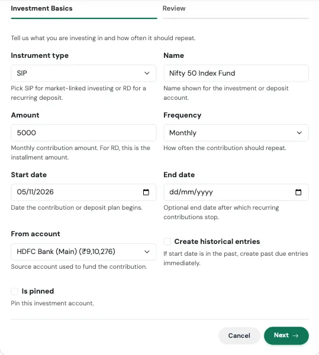{ loading=lazy width="560" }

| फील्ड | काय भरायचे |
|---|---|
| **Instrument type** | बाजाराशी जोडलेल्या गुंतवणुकीसाठी **SIP**, किंवा आवर्ती ठेवीसाठी **RD**. |
| **Name** | गुंतवणुकीसाठी दिसणारे नाव, उदा. "Nifty 50 Index Fund". |
| **Amount** | मासिक योगदान. RD साठी ही हप्त्याची रक्कम आहे. |
| **Frequency** | डिफॉल्टनुसार Monthly. |
| **Start date** | योजना सुरू होण्याची तारीख. |
| **End date** | पर्यायी. ज्या तारखेनंतर योगदान थांबते, उदा. RD संपल्यावर. |
| **From account** | ज्या बँक खात्यातून पैसे वजा होतात. |
| **Create historical entries** | सुरू होण्याची तारीख मागे गेली असेल आणि आधीची योगदाने आता जोडायची असतील तर चालू करा. |
| **Is pinned** | पर्यायी. खाते तुमच्या यादीत सर्वात वर ठेवते. |

**पायरी 2: Recurring Deposit Details** (फक्त **RD** निवडल्यावरच दिसते)

| फील्ड | काय भरायचे |
|---|---|
| **Deposit principal** | सुरुवातीची रक्कम, असल्यास. |
| **Deposit rate** | वार्षिक व्याजदर. |
| **Deposit compounding** | व्याज किती वेळा जोडले जाते: साधे, तिमाही, मासिक किंवा वार्षिक. |
| **Deposit maturity date** | RD कधी संपते. |
| **RD installment day** | महिन्याचा तो दिवस जेव्हा हप्ता नोंदवला जातो. |
| **Show accrued balance** | फक्त तुम्ही भरलेल्या रकमेऐवजी आतापर्यंत मिळालेल्या व्याजासह शिल्लक दाखवा. |
| **Record maturity income** | RD पूर्ण झाल्यावर व्याज उत्पन्न म्हणून नोंदवा. |

**आढावा आणि खात्री (Review and confirm)**

शेवटचा टॅब काहीही सेव्ह होण्यापूर्वी काय तयार होणार आहे ते सांगतो, आणि सर्वात वर मुख्य आकडा दाखवतो. तो तपासा, मग **Confirm and create** दाबा. कोणत्याही कार्डावरील **Edit** वापरून त्या पायरीवर परत जाता येते.

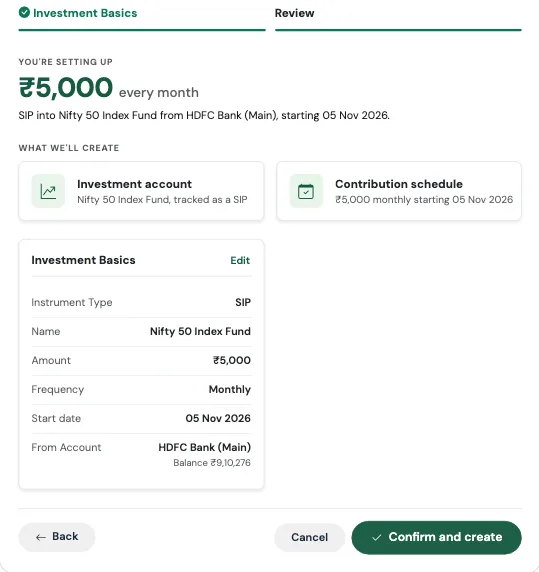{ loading=lazy width="560" }

### काय तयार होते

- एक **गुंतवणूक खाते**: SIP साठी Mutual Funds खाते, किंवा आवर्ती ठेवीसाठी RD खाते
- तुमच्या बँक खात्यातून त्यात एक **आवर्ती मासिक हस्तांतरण**

Review स्क्रीनवर सर्वात वर मासिक रक्कम दिसते, आणि त्यानंतर सोप्या भाषेतील एक ओळ, उदा. *"SIP into Nifty 50 Index Fund from HDFC Salary, starting 15 Oct 2026."*

!!! example "प्रत्यक्ष वापराचे उदाहरण"
    आदित्य ठरवतो की तो दर महिन्याला ₹5,000 Nifty 50 इंडेक्स फंडात गुंतवेल, आणि पैसे दर 5 तारखेला त्याच्या पगाराच्या खात्यातून वजा होतील.

    तो **I started a SIP** चालवतो, प्रकार SIP ठेवतो, नाव "Nifty 50 Index Fund" देतो, 5000 भरतो, Monthly निवडतो, सुरुवातीची तारीख 5 नोव्हेंबर ठेवतो आणि त्याचे HDFC Salary खाते निवडतो. Review वर त्याला *"₹5,000 every month"* आणि दोन कार्ड दिसतात: गुंतवणूक खाते आणि योगदानाचे वेळापत्रक. खात्री केल्यानंतर दर 5 तारखेला त्याच्या पगाराच्या खात्यातून ₹5,000 कमी होतात आणि Mutual Funds खात्यात तितकेच वाढतात. त्या दिवशी त्याची निव्वळ संपत्ती बदलत नाही, कारण पैसे फक्त एका खिशातून दुसऱ्या खिशात गेले आहेत, पण त्याच्या मालमत्तेच्या वाटणीत आता इक्विटीचाही समावेश आहे.

### लक्षात ठेवा

!!! tip "फंडाचे खरे मूल्य"
    हा Flow फक्त तुम्ही टाकलेले पैसे नोंदवतो. फंडाचे प्रत्यक्ष युनिट आणि त्यांचे सध्याचे मूल्य ट्रॅक करण्यासाठी नंतर तुमच्या होल्डिंग्स जोडा, आणि प्रत्येक हप्ता ज्या फंडात गेला त्याच्याशी **Buy more → Paid by transfer** वापरून जोडा. पहा [होल्डिंग्स आणि म्युच्युअल फंड](../02-accounts/holdings.mr.md) आणि [Accrued विरुद्ध Invested व्ह्यू](../02-accounts/accrued-vs-invested.mr.md).

!!! warning "SIP आणि RD सारख्या गोष्टी नाहीत"
    SIP चे मूल्य बाजारानुसार वर-खाली होते. RD चे मूल्य ठरलेल्या दराने वाढते. तुम्ही RD निवडल्यास दुसरी पायरी जरूर भरा, नाहीतर व्याज ट्रॅक होणार नाही.

---

## मी FD बुक केली (I Booked an FD)

> *मुद्दल, दर आणि मुदतपूर्ती, पूर्ण होईपर्यंत ट्रॅक.*

### झाड लावण्यासारखे समजा

तुम्ही बी जमिनीत पेरता (मुद्दल), आणि फळ साधारण कधी येईल हे तुम्हाला माहीत असते (मुदतपूर्तीची तारीख). मधल्या काळात ते शांतपणे वाढत राहते. FD Flow TrackMyRupee ला सांगतो की बी कुठून आले, ते किती वेगाने वाढते, आणि फळाची अपेक्षा कधी करायची.

### कधी वापरावे

नवीन फिक्स्ड डिपॉझिट बुक करताना. यासाठी सुमारे एक मिनिट लागतो.

### तुम्हाला काय भरायचे आहे

**पायरी 1: Deposit Basics**

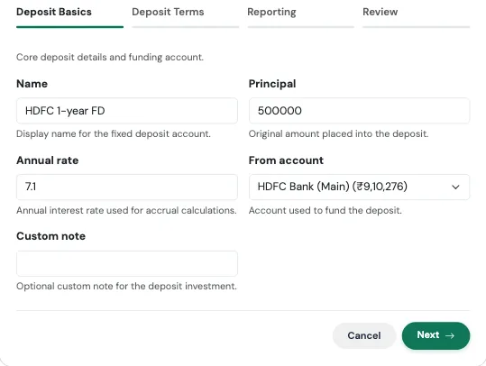{ loading=lazy width="560" }

| फील्ड | काय भरायचे |
|---|---|
| **Name** | एक लेबल, उदा. "SBI 1-year FD". |
| **Principal** | तुम्ही ठेवीत टाकलेली रक्कम. |
| **Annual rate** | वार्षिक व्याजदर. |
| **From account** | ठेवीसाठी ज्या खात्यातून पैसे आले ते खाते. |
| **Custom note** | पर्यायी. फंडिंग नोंदीची डिफॉल्ट टीप बदलते. |

**पायरी 2: Deposit Terms**

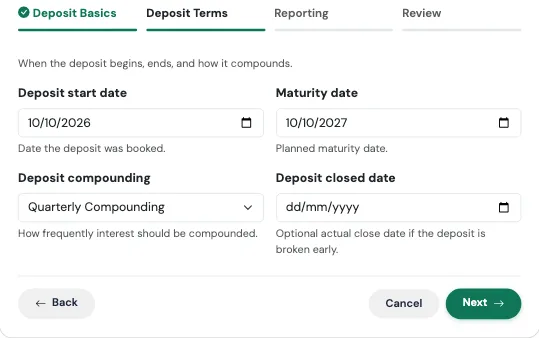{ loading=lazy width="560" }

| फील्ड | काय भरायचे |
|---|---|
| **Deposit start date** | ज्या दिवशी तुम्ही ती बुक केली. |
| **Maturity date** | ती कधी परिपक्व होते. |
| **Deposit compounding** | Simple, Quarterly, Monthly किंवा Annual. बँकांच्या FD साठी Quarterly सर्वात सामान्य आहे. |
| **Deposit closed date** | पर्यायी. FD मुदतीआधी मोडली असेल तरच लागते. |

**पायरी 3: Reporting**

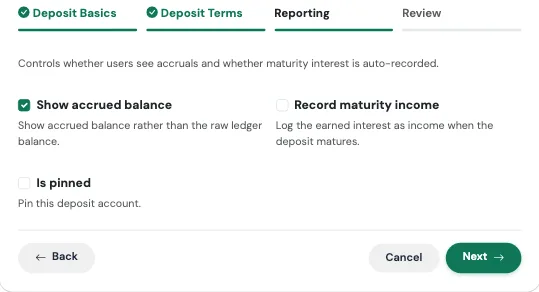{ loading=lazy width="560" }

| फील्ड | काय भरायचे |
|---|---|
| **Show accrued balance** | डिफॉल्टनुसार चालू. फक्त गुंतवलेल्या रकमेऐवजी आतापर्यंत मिळालेल्या व्याजासह मूल्य दाखवते. |
| **Record maturity income** | डिफॉल्टनुसार बंद. चालू केल्यास मुदतपूर्तीच्या तारखेला व्याज उत्पन्न म्हणून नोंदवले जाते. |
| **Is pinned** | पर्यायी. खाते तुमच्या यादीत सर्वात वर ठेवते. |

**आढावा आणि खात्री (Review and confirm)**

शेवटचा टॅब काहीही सेव्ह होण्यापूर्वी काय तयार होणार आहे ते सांगतो, आणि सर्वात वर मुख्य आकडा दाखवतो. तो तपासा, मग **Confirm and create** दाबा. कोणत्याही कार्डावरील **Edit** वापरून त्या पायरीवर परत जाता येते.

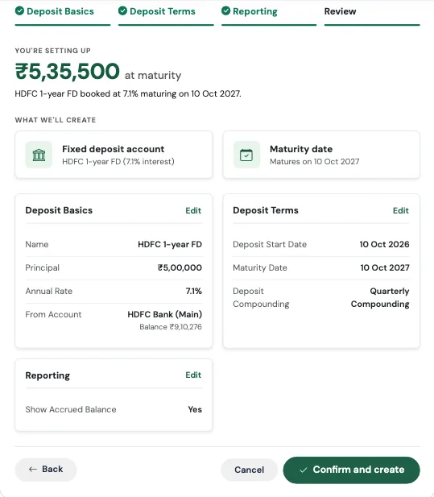{ loading=lazy width="560" }

### काय तयार होते

- तुम्ही भरलेला दर, तारखा आणि compounding असलेले एक **फिक्स्ड डिपॉझिट खाते**
- एक **एकरकमी फंडिंग नोंद**, जी *Investment Lump Sum* प्रकारचा Capital Event म्हणून नोंदवली जाते आणि सुरुवातीच्या तारखेला फंडिंग खात्यातून मुद्दल वजा करते
- **मुदतपूर्ती ट्रॅकिंग**, ज्यामुळे तिची किंमत किती होईल आणि कधी, ते दिसते

Review स्क्रीनवर मुदतपूर्तीला मिळणाऱ्या रकमेचा झटपट अंदाज दिसतो, उदा. *₹5,35,000 at maturity*.

!!! example "प्रत्यक्ष वापराचे उदाहरण"
    सुनीता 10 ऑक्टोबरला तिच्या बचत खात्यातून ₹5,00,000 ची एक वर्षाची FD 7% दराने, तिमाही compounding सह बुक करते.

    ती **I booked an FD** चालवते, तपशील भरते, **Show accrued balance** चालू ठेवते आणि **Record maturity income** चालू करते. Review वर तिला *"₹5,35,000 at maturity"* दिसते. हा आकडा झटपट अंदाज आहे. तिची बँक तिमाही compounding करते, त्यामुळे प्रत्यक्षात थोडी जास्त रक्कम देईल, सुमारे ₹5,35,930, आणि ॲपचे accrued balance तुम्ही निवडलेल्या compounding नुसार चालते. पुढच्या वर्षी 10 ऑक्टोबर उलटल्यानंतर, ॲप उघडताच व्याज उत्पन्न म्हणून नोंदवले जाते, त्यामुळे त्या महिन्याच्या तिच्या बचत दरात ते दिसते, आणि तिला स्वतः आठवणीने नोंद करावी लागत नाही.

### लक्षात ठेवा

!!! note "तारखा तुमच्यासाठी तपासल्या जातात"
    फॉर्म सुरुवातीच्या तारखेला किंवा त्याआधी असलेली मुदतपूर्तीची तारीख स्वीकारणार नाही, तसेच सुरुवातीच्या तारखेआधीची बंद केल्याची तारीखही स्वीकारणार नाही. हीच तपासणी RD आणि PPF / EPF / NPS ला, त्यांच्या समाप्तीच्या तारखांसह, लागू होते.

!!! warning "माझी बँक शिल्लक का कमी झाली?"
    फंडिंग नोंद आपले काम करत आहे. तुम्ही FD बुक केलेल्या दिवशी मुद्दल खरोखरच तुमच्या बचत खात्यातून बाहेर गेले. ते FD शिल्लक म्हणून पुन्हा दिसते, त्यामुळे तुमची निव्वळ संपत्ती तीच राहते.

!!! tip "मुद्दल Capital Event का आहे"
    FD मध्ये ₹5,00,000 टाकणे हा खर्च नाही. ते Capital Event म्हणून नोंदवल्याने ते तुमच्या मासिक खर्चातून आणि बजेटमधून बाहेर राहते, त्यामुळे तुमच्या Dashboard वर अचानक तुम्ही जास्त खर्च केल्यासारखे दिसत नाही. पहा [Capital Events](../09-capital-events/index.mr.md).

---

## मी PPF / EPF / NPS मध्ये योगदान देतो (I Contribute to PPF / EPF / NPS)

> *तुमच्या निवृत्ती योजनेत वार्षिक किंवा मासिक योगदान.*

### लांब पल्ल्याच्या रेल्वेत चढण्यासारखे समजा

तुम्ही एका दिवसात ठिकाणावर पोहोचत नाही. तुम्ही वर्षातून एकदा चढता, बसता, आणि प्रवासाला वर्षानुवर्षे लागतात. महत्त्वाचे म्हणजे तुम्ही चढत राहणे. हा Flow तुमचे चढणे म्हणजे वार्षिक योगदान ट्रॅक करतो, आणि प्रवासाची प्रगती म्हणजे वाढणारी शिल्लकही.

### कधी वापरावे

Public Provident Fund, Employees' Provident Fund किंवा National Pension System खात्यासाठी, ज्यात तुम्ही नियमित योगदान देता. यासाठी सुमारे एक मिनिट लागतो.

### तुम्हाला काय भरायचे आहे

**पायरी 1: Scheme Basics**

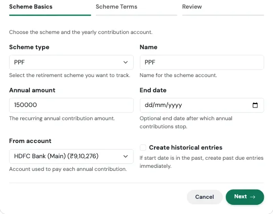{ loading=lazy width="560" }

| फील्ड | काय भरायचे |
|---|---|
| **Scheme type** | PPF, EPF किंवा NPS. |
| **Name** | खात्याचे लेबल, उदा. "SBI PPF". |
| **Annual amount** | वार्षिक योगदान. |
| **End date** | पर्यायी. या तारखेनंतर योगदान थांबते. |
| **From account** | ज्या खात्यातून प्रत्येक योगदानाचे पैसे दिले जातात. |
| **Create historical entries** | मागील वर्षांची योगदाने जोडण्यासाठी चालू करा. |

**पायरी 2: Scheme Terms**

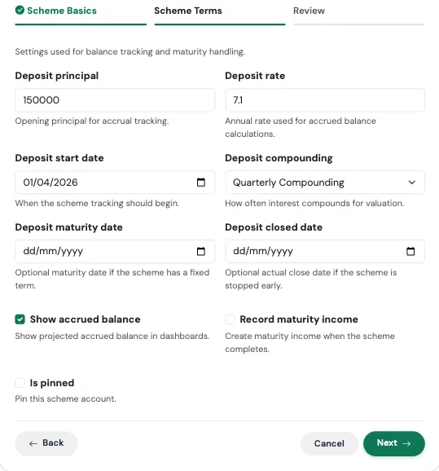{ loading=lazy width="560" }

| फील्ड | काय भरायचे |
|---|---|
| **Deposit principal** | योजनेत तुमच्याकडे आधीपासून असलेली शिल्लक. |
| **Deposit rate** | वाढीचा अंदाज घेण्यासाठी वापरला जाणारा वार्षिक दर. |
| **Deposit start date** | ट्रॅकिंग कधी सुरू होते. |
| **Deposit compounding** | व्याज किती वेळा compound होते. |
| **Deposit maturity date** | पर्यायी, ठराविक मुदतीच्या योजनांसाठी. |
| **Deposit closed date** | पर्यायी, तुम्ही मुदतीआधी थांबवली असल्यास. |
| **Show accrued balance** | व्याजासह अंदाजित शिल्लक दाखवा. |
| **Record maturity income** | योजना पूर्ण झाल्यावर उत्पन्न तयार करा. |
| **Is pinned** | पर्यायी. खाते सर्वात वर ठेवते. |

**आढावा आणि खात्री (Review and confirm)**

शेवटचा टॅब काहीही सेव्ह होण्यापूर्वी काय तयार होणार आहे ते सांगतो, आणि सर्वात वर मुख्य आकडा दाखवतो. तो तपासा, मग **Confirm and create** दाबा. कोणत्याही कार्डावरील **Edit** वापरून त्या पायरीवर परत जाता येते.

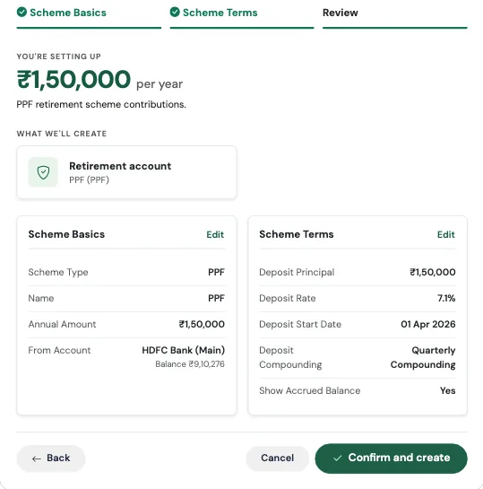{ loading=lazy width="560" }

### काय तयार होते

- तुमची शिल्लक ठेवणारे एक **योजना खाते** (PPF, EPF किंवा NPS)
- तुमच्या बँक खात्यातून त्यात एक **आवर्ती वार्षिक हस्तांतरण**, ज्यावर वार्षिक गुंतवणूक योगदान असे लेबल असते

!!! example "प्रत्यक्ष वापराचे उदाहरण"
    विक्रम सहा वर्षांपासून त्याच्या PPF मध्ये पैसे टाकतो आहे आणि त्यात ₹4,20,000 जमा आहेत. त्याला दर एप्रिलमध्ये त्याच्या SBI खात्यातून ₹1,50,000 त्यात जायला हवे आहेत.

    तो **I contribute to PPF / EPF / NPS** चालवतो, PPF निवडतो, वार्षिक रक्कम 150000 भरतो, आणि deposit principal 420000 टाकतो, दर 7.1%, वार्षिक compounding आणि सुरुवातीची तारीख 1 एप्रिल. पुढच्या एप्रिलमध्ये ₹1,50,000 आपोआप SBI मधून त्याच्या PPF खात्यात जातात. त्याची निव्वळ संपत्ती कमी होत नाही, कारण हे हस्तांतरण आहे, आणि त्याच्या Accounts पेजवरील PPF शिल्लक त्याने ठरवलेल्या दराने वाढत राहते.

### लक्षात ठेवा

!!! warning "तुमच्याकडे आधीपासून असलेली शिल्लकच भरा"
    योजनेत तुमची सहा वर्षांची बचत असेल आणि तुम्ही **Deposit principal** शून्य ठेवले, तर तुमची निव्वळ संपत्ती प्रत्यक्षापेक्षा कमी दिसेल. शून्य नाही, तुमची सध्याची शिल्लक भरा.

!!! warning "EPF सहसा पगारातून कापला जातो"
    तुमचा नियोक्ता तुमचा EPF थेट तुमच्या पेस्लिपमधून भरत असेल, तर ते पैसे तुमच्या बँक खात्यातून कधीच जात नाहीत, त्यामुळे बँक खात्यातून वार्षिक हस्तांतरण वास्तवाशी जुळणार नाही. EPF साठी तुम्ही खाते [खाती](../02-accounts/index.mr.md) पेजवरून जोडून अधूनमधून पासबुकवरून त्याची शिल्लक अपडेट करणे पसंत कराल. हा Flow PPF आणि NPS साठी सर्वात योग्य आहे, जिथे तुम्ही स्वतः पैसे भरता.

---

## मी एखाद्या गोष्टीसाठी बचत करत आहे (I'm Saving for Something)

> *इमर्जन्सी फंड, सहल, मोठी खरेदी, उद्दिष्ट ठरवा.*

### कपाटातल्या लेबल लावलेल्या डब्यासारखे समजा

"गोवा सहल, डिसेंबर" असे लिहिलेल्या डब्यातले पैसे काढणे, पैशांच्या सामान्य ढिगातून काढण्यापेक्षा खूप कठीण असते. लेबल प्रत्येक रुपयाला एक हेतू देते, आणि मुदत तुम्हाला वेग देते. हा Flow ॲपमध्ये तोच डबा तयार करतो, उद्दिष्ट आणि तारखेसह.

### कधी वापरावे

ज्या कशासाठी तुम्ही बचत करत आहात त्यासाठी: इमर्जन्सी फंड, सुट्टी, लग्न, डाउन पेमेंट, नवीन लॅपटॉप. यासाठी एक मिनिटापेक्षा कमी वेळ लागतो.

### तुम्हाला काय भरायचे आहे

**पायरी 1: Goal Details**

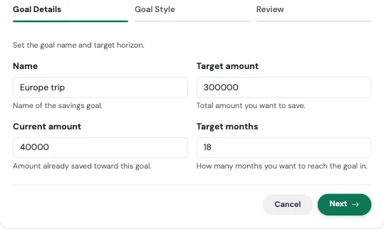{ loading=lazy width="560" }

| फील्ड | काय भरायचे |
|---|---|
| **Name** | तुम्ही कशासाठी बचत करत आहात. |
| **Target amount** | तुम्हाला गाठायची एकूण रक्कम. |
| **Current amount** | पर्यायी. तुम्ही आधीच बाजूला ठेवलेली रक्कम. |
| **Target months** | तुम्ही स्वतःला किती महिने देता. |

**पायरी 2: Goal Style** (पर्यायी)

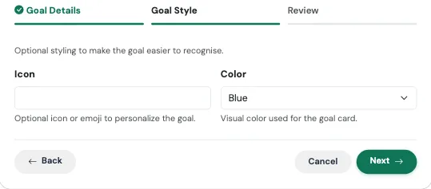{ loading=lazy width="560" }

| फील्ड | काय भरायचे |
|---|---|
| **Icon** | उद्दिष्ट एका नजरेत ओळखण्यासाठी आयकॉन किंवा इमोजी. |
| **Color** | उद्दिष्ट कार्डाचा रंग: Blue, Green, Red, Yellow किंवा Light Blue. |

**आढावा आणि खात्री (Review and confirm)**

शेवटचा टॅब काहीही सेव्ह होण्यापूर्वी काय तयार होणार आहे ते सांगतो, आणि सर्वात वर मुख्य आकडा दाखवतो. तो तपासा, मग **Confirm and create** दाबा. कोणत्याही कार्डावरील **Edit** वापरून त्या पायरीवर परत जाता येते.

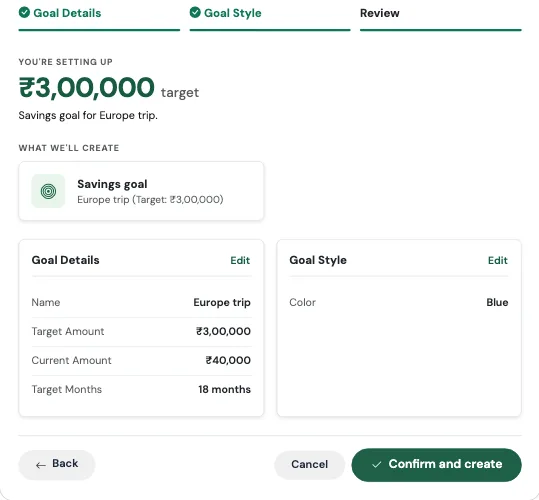{ loading=lazy width="560" }

### काय तयार होते

- तुमच्या लक्ष्यासह एक **बचत उद्दिष्ट**, आणि आजपासून तितक्या महिन्यांनंतरची लक्ष्य तारीख
- तुमच्या [बचत उद्दिष्टे](../12-goals/index.mr.md) पेजवर एक उद्दिष्ट कार्ड, जिथे तुम्ही प्रगती पाहता आणि योगदान जोडता

तुमची योजना तपासण्याचा एक सोपा मार्ग: उद्दिष्टातून आधी जमवलेली रक्कम वजा करा आणि महिन्यांच्या संख्येने भागा. इतकी रक्कम तुम्हाला दर महिन्याला बाजूला ठेवावी लागेल.

!!! example "प्रत्यक्ष वापराचे उदाहरण"
    अनन्या आणि तिचे मित्र 18 महिन्यांनंतर गोवा सहलीचे नियोजन करत आहेत. विमान प्रवासासह तिच्या वाट्याचा अंदाज ₹3,00,000 आहे, आणि तिच्याकडे आधीच ₹30,000 जमा आहेत.

    ती **I'm saving for something** चालवते आणि "Goa trip", 300000, 30000 आणि 18 भरते. हिशोब सोपा आहे: 18 महिन्यांत उरलेले ₹2,70,000 म्हणजे दर महिन्याला ₹15,000. ती नारळाच्या झाडाचा आयकॉन असलेले Blue कार्ड निवडते आणि खात्री करते. दर महिन्याला ती उद्दिष्टात पैसे जोडते तसतशी प्रगती पट्टी भरत जाते, आणि सहल हा अस्पष्ट विचार न राहता तारीख असलेला एक आकडा बनतो.

### लक्षात ठेवा

!!! tip "उद्दिष्ट म्हणजे वेगळे बँक खाते नाही"
    उद्दिष्ट फक्त लक्ष्याकडे होणारी प्रगती ट्रॅक करते. ते तयार केल्याने कोणतेही पैसे हलत नाहीत. नंतर तुम्ही नोंदवलेले प्रत्येक **योगदान** तुम्ही निवडलेल्या खात्यातून ती रक्कम काढून उद्दिष्टात जोडते. पैसे वेगळे ठेवायचे असतील, तर ते वेगळ्या खात्यात ठेवा आणि योगदाने त्यातूनच नोंदवा.

---

## संबंधित लिंक्स
- [TMR Flows चा आढावा](index.mr.md)
- [होल्डिंग्स आणि म्युच्युअल फंड](../02-accounts/holdings.mr.md)
- [Accrued विरुद्ध Invested व्ह्यू](../02-accounts/accrued-vs-invested.mr.md)
- [हस्तांतरण](../06-transfers/index.mr.md)
- [Capital Events](../09-capital-events/index.mr.md)
- [बचत उद्दिष्टे](../12-goals/index.mr.md)
