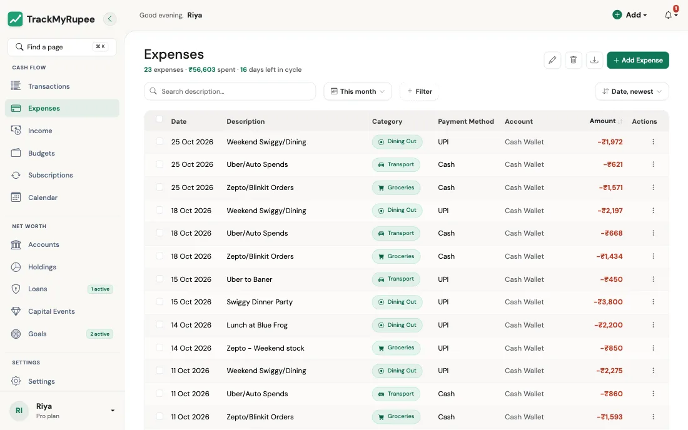
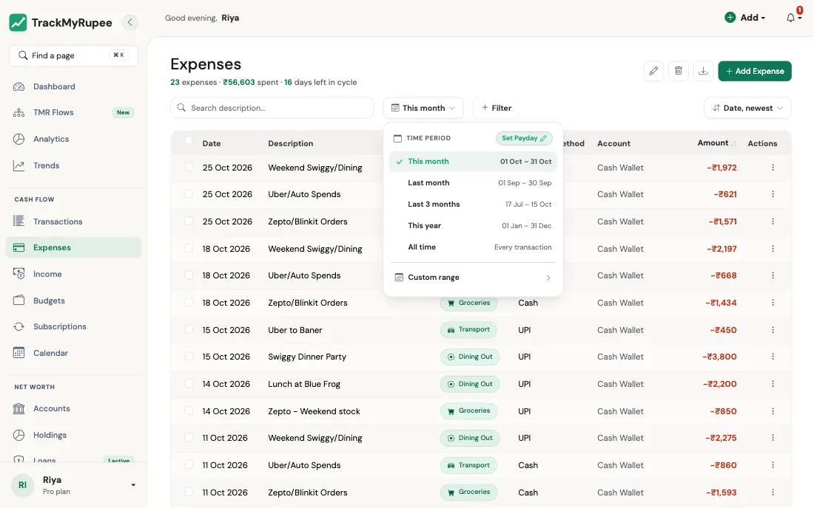
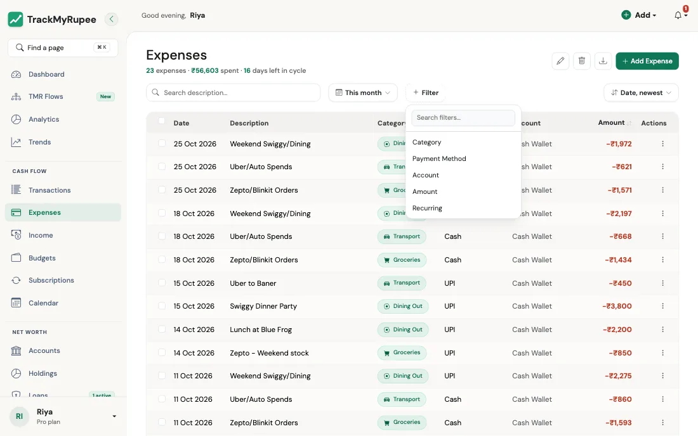
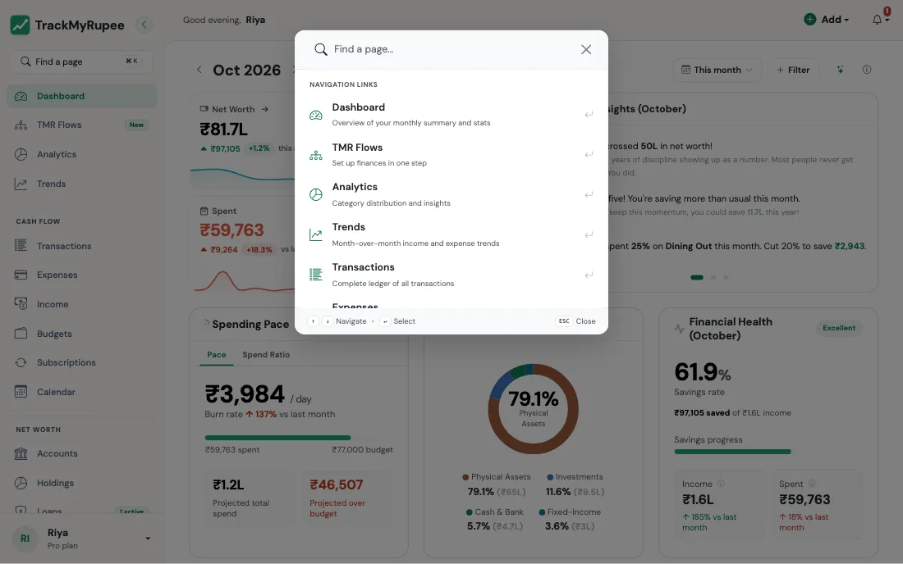

# शोध, फिल्टर आणि क्रमवारी (Searching, Filtering and Sorting)

तुम्हाला हवे असलेले नेमके व्यवहार शोधा, आणि फक्त त्यांचीच बेरीज पाहा.

---

## 1. फिल्टर बार (The Filter Bar)

एखादे चांगले किराणा दुकान कसे मांडलेले असते ते आठवा. तांदूळ एका कप्प्यात, डाळी दुसऱ्यात, आणि लेबल सांगतात कुठे पाहायचे. तुम्ही दुकानात जाऊन दुकानदाराला "जे काही विकतोस ते सगळे वाचून दाखव" असे म्हणत नाही. फिल्टर बार म्हणजे तुमच्या पैशांसाठीची अशीच लेबले.

{ loading=lazy }

TrackMyRupee मधील जवळजवळ प्रत्येक यादीच्या वरच्या भागात हाच बार असतो, त्यामुळे एका पेजवर शिकलात की सर्वत्र वापरता येतो:

| भाग | हे काय करते |
|---|---|
| **Search box** | एखादा शब्द टाइप करा आणि तुम्ही टाइप करता तशी यादी लहान होत जाते, उदा. "swiggy". एक लहान क्लिअर बटन दिसते, ज्याने तुम्ही शोध एका टॅपमध्ये रिकामा करू शकता. |
| **Time period** | तुम्ही कोणत्या तारखा पाहत आहात ते निवडते. |
| **+ Filter** | श्रेणी, खाते किंवा रक्कम अशा आणखी अटी जोडते. |
| **Sort** (उजवीकडे) | क्रम निवडते, उदा. *Date, newest* किंवा *Amount, highest*. |

हा बार Dashboard, Expenses, Income, Transactions, Accounts, Subscriptions, Capital Events, Categories, तसेच खाते आणि बचत उद्दिष्टाच्या तपशील पेजवर दिसतो.

---

## 2. कालावधी निवडणे (Choosing a Time Period)

कालावधीच्या बटणावर क्लिक करा (सुरुवातीला ते **This month** दाखवते). एक लहान मेनू उघडतो, ज्यात प्रत्येक पर्यायापुढे त्याची तारखांची मर्यादा दिसते:

{ loading=lazy }

- **This month**
- **Last month**
- **Last 3 months**
- **This year**
- **All time**
- **Custom range**: शॉर्टकटमध्ये न बसणाऱ्या कालावधीसाठी **From** आणि **Until** तारीख निवडा

### "This month" तुमच्या पगाराच्या दिवसाला अनुसरते

तुम्ही पगाराची तारीख सेट केली असेल, तर "महिना" म्हणजे 1 ते 31 तारीख नसते. त्याचा अर्थ तुमचे **salary cycle** असतो, म्हणजे एका पगाराच्या दिवसापासून पुढच्या पगाराच्या आदल्या दिवसापर्यंत. मग मेनूमध्ये त्या सायकलच्या खऱ्या तारखा दिसतात, तसेच साध्या **Calendar Month** वर जाण्याचे किंवा **Previous Cycle** पाहण्याचे पर्याय दिसतात.

तुम्ही अजून पगाराचा दिवस सेट केला नसेल, तर मेनूमध्ये **Set Payday** शॉर्टकट दिसतो. तुम्ही तो [I started a new job](../13-tmr-flows/income-and-bills.md) Flow ने देखील सेट करू शकता.

!!! example "प्रत्यक्ष वापराचे उदाहरण"
    इम्रानचा पगार 28 तारखेला येतो. महिन्याच्या 5 तारखेला साधा "calendar month" व्ह्यू म्हणेल की त्याने जवळजवळ काहीच खर्च केलेले नाही, कारण महिना "नुकताच सुरू झाला" आहे. त्याचा salary cycle व्ह्यू खरे सांगतो: तो या पगारातून आधीच एक आठवडा खर्च करत आहे. Calendar Month वर जाणे फक्त तेव्हाच उपयोगी आहे जेव्हा त्याला बँक स्टेटमेंटशी ताळमेळ घालायचा असतो, कारण ते calendar month वर चालते.

---

## 3. फिल्टर जोडणे (Adding Filters)

**+ Filter** वर क्लिक करा. एक लहान मेनू उघडतो, आणि यादी मोठी असल्यास वरती एक लहान शोध बॉक्स असतो. एखादा फिल्टर निवडा, आणि तो बारच्या अगदी खाली **chip** म्हणून दिसतो, त्यावर त्याचे नाव आणि मूल्य असते, उदा. **Category: Any**.

{ loading=lazy }

- कोणती मूल्ये हवी ते निवडण्यासाठी **chip वर क्लिक करा**. तुम्ही एकापेक्षा जास्त निवडू शकता.
- फक्त तो फिल्टर काढण्यासाठी chip वरील लहान **x** वर क्लिक करा.
- सर्व फिल्टर काढून पुन्हा सुरुवात करण्यासाठी **Clear all** वर क्लिक करा.

फिल्टर एकमेकांसोबत काम करतात. दोन निवडल्यास **दोन्हींशी** जुळणारेच दिसते.

### रकमेच्या मर्यादा आणि "No account"

**Amount** फिल्टरमध्ये *Under 500*, *500 to 2,000*, *2,000 to 10,000* आणि *Over 10,000* अशा मर्यादा मिळतात. त्या तुमच्या स्वतःच्या चलनात असतात, आणि रक्कम त्यात रूपांतरित करून मोजली जाते. प्रत्येक मर्यादेत तिची खालची सीमा येते, त्यामुळे नेमके 2,000 हे *2,000 to 10,000* मध्ये येते, *500 to 2,000* मध्ये नाही, आणि प्रत्येक रक्कम नेमक्या एकाच मर्यादेत असते.

Expenses, Income आणि Capital Events पेजवर **Account** फिल्टरमध्ये **No account** हा पर्याय देखील असतो. प्रत्येक व्यवहाराला खाते आवश्यक होण्यापूर्वी सेव्ह केलेल्या जुन्या नोंदी तो दाखवतो. त्यातील एखादी उघडा आणि खाते निवडा, म्हणजे ती त्या खात्याच्या शिल्लकीत मोजली जाईल.

### कोणत्या पेजवर कशाने फिल्टर करता येते

| पेज | उपलब्ध फिल्टर |
|---|---|
| **Dashboard** | Category, Payment Method, Account |
| **Expenses** | Category, Payment Method, Account, Amount, Recurring |
| **Income** | Source Type, Income Group, Account, Amount |
| **Transactions** | Transaction Type, Account, Amount |
| **Subscriptions** | Category, Billing Cycle, Status, Account, Type |
| **Capital Events** | Event Type, Account, Amount |
| **Accounts** | Account Type, Status, Pinned |
| **Categories** | Budget |
| **एकच खाते** | Transaction Type, Category, Amount |
| **एक बचत उद्दिष्ट** | Account, Amount |

!!! tip "Income Group फिल्टर"
    उत्पन्नाचे **Earned** (पगार, फ्रीलान्स, व्यवसाय), **Passive** (गुंतवणुकीवरील परतावा, भाडे), किंवा **One-off** (रिवॉर्ड, रिफंड, इतर) असे गट करता येतात. तुमचे किती उत्पन्न कष्टाने आले आणि किती आपोआप आले हे यामुळे पटकन दिसते.

---

## 4. क्रमवारी लावणे (Sorting)

बारच्या उजवीकडील sort कंट्रोल वापरा. पर्याय पेजनुसार बदलतात. तारखा असलेल्या याद्यांमध्ये *Date, newest* आणि *Date, oldest* मिळतात, तसेच *Amount, highest* आणि *Amount, lowest*. Accounts शिल्लक किंवा नावाने, Categories नावाने किंवा मासिक मर्यादेने, आणि Subscriptions त्या किती लवकर नूतनीकृत होणार आहेत त्यानुसार लावता येतात.

Expenses, Income आणि Transactions टेबलमध्ये तुम्ही **Amount** स्तंभाच्या शीर्षकावर क्लिक करून सर्वात जास्त आधी आणि सर्वात कमी आधी यांमध्येही बदलू शकता.

---

## 5. फिल्टरसोबत बेरीजही बदलते (The Totals Change With Your Filters)

पेजच्या शीर्षकाखालील ओळ केवळ शोभेसाठी नाही. उदाहरणार्थ Expenses वर ती काहीशी अशी दिसते: *"9 expenses, ₹27,380 spent, 21 days left in cycle"*, आणि तुम्ही जे काही फिल्टर कराल त्यानुसार ती अपडेट होते. एका श्रेणीवर फिल्टर केल्यास संख्या आणि बेरीज फक्त त्या श्रेणीची असते.

फिल्टर करताना पेजचा पत्ताही बदलतो. म्हणजे "Food, last 3 months" सारखा फिल्टर केलेला व्ह्यू तुम्ही **बुकमार्क** करून नंतर परत येऊ शकता.

!!! example "प्रत्यक्ष वापराचे उदाहरण"
    मीराला शंका आहे की ती फूड डिलिव्हरीवर खूप जास्त खर्च करते. ती Expenses उघडते, कालावधी **Last 3 months** ठेवते, Food वर सेट केलेला **Category** फिल्टर आणि UPI वर सेट केलेला **Payment Method** फिल्टर जोडते. शीर्षकाखालील ओळ आता सांगते की तिने UPI ने Food चे किती पेमेंट केले आणि त्यांची एकूण बेरीज किती. ती तिच्या अंदाजापेक्षा जास्त निघते. ती पेज बुकमार्क करते, म्हणजे पुढच्या महिन्यात हा आकडा कमी झाला का ते तिला पाहता येईल.

---

## 6. पेज पटकन शोधणे (Finding a Page Quickly)

डेस्कटॉप साइडबारच्या अगदी वर **Find a page** असे लिहिलेला एक बॉक्स आहे, त्याच्या शेजारी शॉर्टकटची खूण आहे. अॅपमध्ये कुठूनही Mac वर **Cmd + K** किंवा Windows आणि Linux वर **Ctrl + K** दाबा.

{ loading=lazy }

एक लहान विंडो उघडते. "export" किंवा "categories" असे काहीतरी टाइप करायला सुरुवात करा, आणि पेजांची यादी लहान होत जाते. यादीत वर-खाली जाण्यासाठी **वर आणि खाली बाणांच्या कीज** वापरा, निवडलेले पेज उघडण्यासाठी **Enter**, आणि विंडो बंद करण्यासाठी **Esc** दाबा.

हे म्हणजे प्रत्येक प्लॅटफॉर्मवर फिरून बोर्ड वाचण्याऐवजी स्टेशनवरील उद्घोषकाला विचारणे की तुमची गाडी कोणत्या प्लॅटफॉर्मवर आहे.

---

## संबंधित लिंक
- [खर्च जोडणे](../03-transactions-expenses/index.md)
- [उत्पन्न जोडणे](../04-transactions-income/index.md)
- [बजेट](../07-budgets/index.md)
- [सुरुवात करणे](../01-getting-started/index.md)
