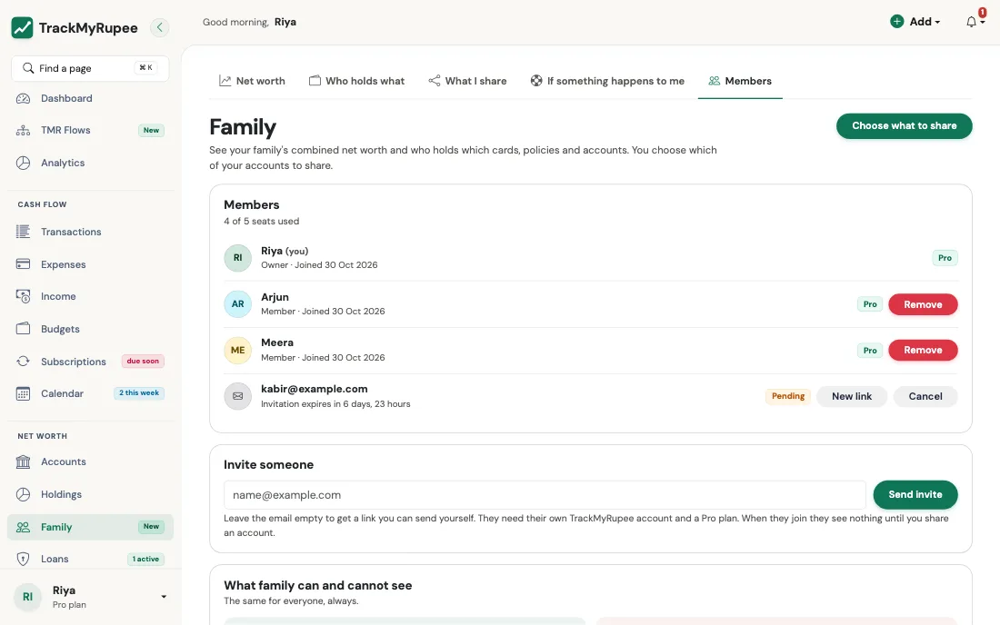
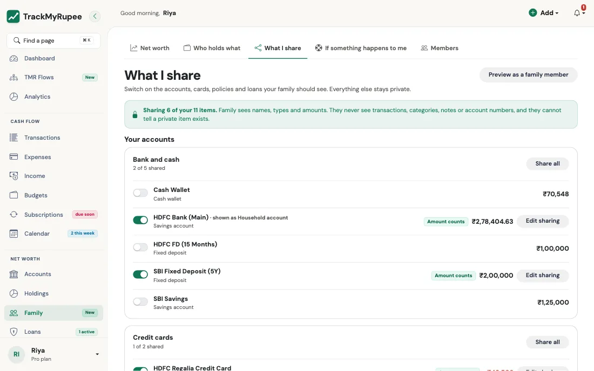
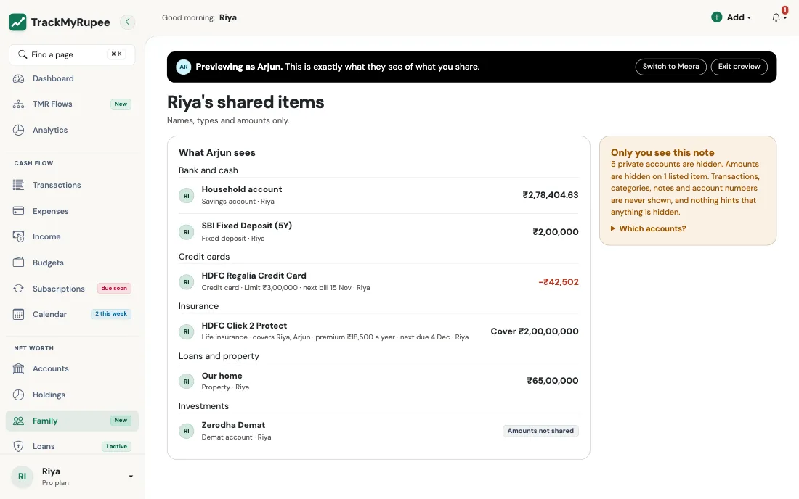
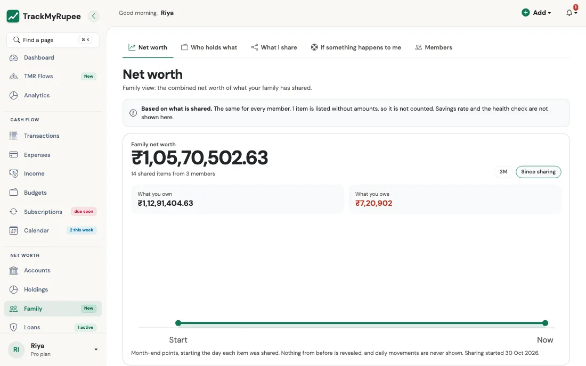
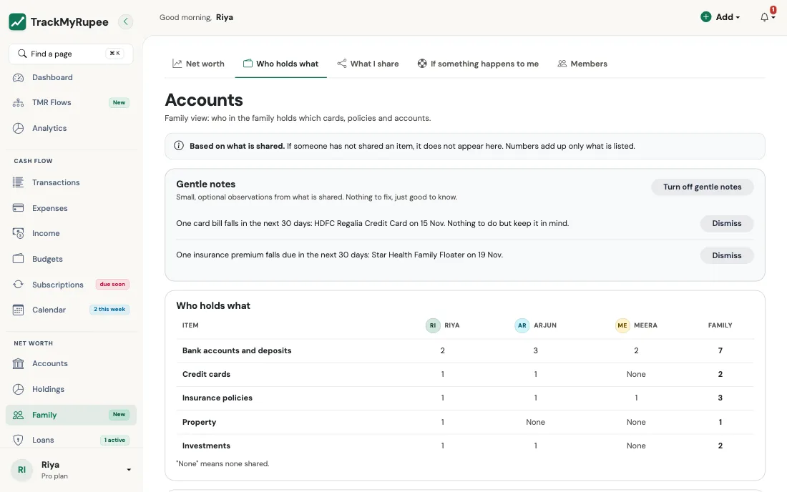
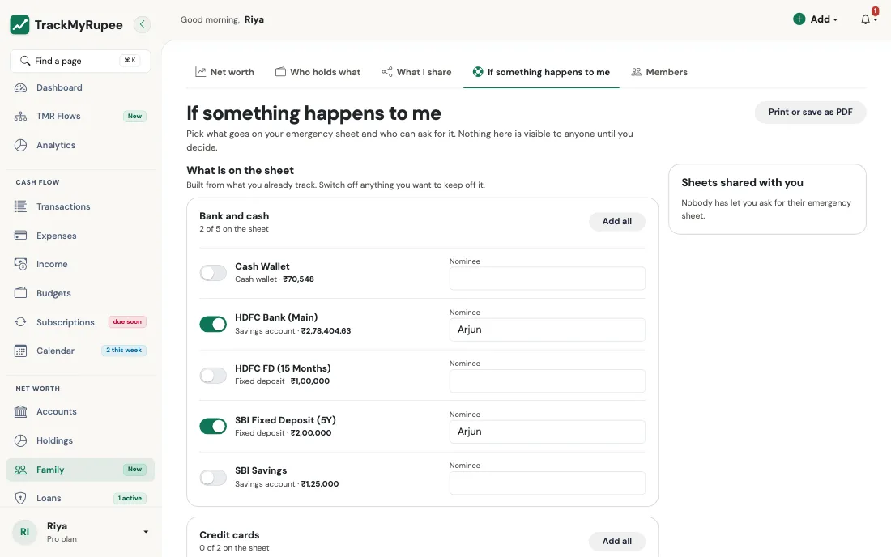

# Family Sharing

Family Sharing answers two questions that no single person's app can:

1. **What is our family's combined net worth?**
2. **Which credit cards, insurance policies and accounts does our family hold, and who holds them?**

Everyone keeps their **own TrackMyRupee account**. Each person chooses which of their accounts to share, and the family sees a combined, **read-only** picture of only what was shared. Nobody can change, or even see, anything you did not share.

!!! info "Pro plan"
    Family view needs **every member on Pro**. See [What happens when a plan ends](#plans-and-what-happens-when-one-ends).

---

## 1. The rules, in short

* **Nothing is shared until you share it.** Joining a family shares nothing at all.
* **Accounts, not transactions.** You share an account (a bank account, card, policy, loan, deposit or property). The family never sees a transaction, category, note, receipt or the holdings inside an account, and never an account or policy number.
* **Same numbers as your own screens.** A shared amount comes from the same valuation as your own net worth, so it never disagrees with what you see.
* **You can see what they see.** A preview shows the family's view of your shared accounts.
* **You are always in control.** Stop sharing one account, or leave the family, and it disappears for everyone at once.

---

## 2. Starting a family

1. Open **Family** in the menu.
2. Choose **Create your family** and give it a name, such as "Our family". You become its **owner**.
3. Under **Invite someone**, choose **Send invite**. Enter an email address to have the link emailed to them, or leave it empty and send the link yourself.

A family has up to **5 members**, and a person can belong to **one family** at a time. Seats taken by members and by open invitations both count, so cancel an unused invitation to free its seat.

{ loading=lazy }

### Joining

The invitation link is single-use and expires after **7 days**. The person opening it must sign in, and must be on **Pro** (an invitee without Pro is offered the 7-day trial or the plans page first). Before joining they see what the family can and cannot see, and accepting records their consent to share.

If a link expires or was cancelled, the owner can cancel it or **renew** it, which issues a fresh link.

---

## 3. Choosing what to share

Open **Family > What I share** to see all your active accounts.

For each account, pick one of two levels:

| Level | What the family sees | Counted in family totals? |
|---|---|---|
| **Show amounts** | The name, type, who holds it, and the amount | Yes |
| **List only** | That the item exists, with no amounts | No |

You can also give an account a **nickname**, shown to the family instead of its real name, so a personal account name never has to be revealed.

{ loading=lazy }

### What each type shows

| Type | Fields the family sees (when amounts are shown) |
|---|---|
| Bank accounts, deposits, investments, property | The balance or value |
| Credit card | Limit, amount used, available credit and the next bill date |
| Insurance | Cover (sum assured), premium and how often, next due date and who it covers |
| Loan | What is outstanding and the EMI |

For an insurance policy you can write **who it covers** (names, as free text) so the family can see who has cover.

### Preview what they see

Choose **Preview as a family member** on **What I share** to see exactly what each member sees of your shared accounts, built by the same code they see it from. Use it before and after changing anything.

{ loading=lazy }

### Stopping, and the activity list

Stop sharing any account at any time. **Sharing activity** lists what you shared, changed or stopped, for your eyes only. If you switch on **Tell family when I share something new**, the other members get a notification when you share a new account.

---

## 4. The family's pages

Members see a **Me / Family** switch on Net worth and Accounts.

### Family net worth

* **Net worth** for the whole family, with **owns** and **owes**.
* **What the family owns**, split across cash, investments, property and other groups.
* **By member**, showing what each person contributes.
* **History**, month by month (see below).

{ loading=lazy }

Only accounts shared with amounts are counted, and only in the viewer's currency. Items shared as **List only**, or shared in another currency, are shown but not counted, and the page says how many.

### Who holds what

A single inventory of the family's **credit cards, insurance, bank accounts and deposits, and loans and property**, with the member who holds each, plus **Coming up in the next 30 days** for card bills and insurance premiums.

{ loading=lazy }

### History

History uses the stored **month-end** net worth snapshots only, never daily ones, because a balance dropping on a given day can reveal a purchase. It counts each account only **from the day its amounts were first shown to the family**, so switching an account from List only to Show amounts never exposes earlier months. The totals in your own snapshots are never reused, because they include private accounts.

---

## 5. Gentle notes

A few calm, optional observations on the family pages, for example that a premium falls due soon or that card bills are coming up. They are built only from what is shared, never compare people, never judge an amount, and say when there is nothing to do.

You can dismiss a note, or switch **Gentle notes** off for yourself. It affects only you.

---

## 6. Emergency access: "If something happens to me"

**Family > If something happens to me** lets you prepare a short sheet for the people you trust.

* **What is on the sheet.** You choose which of your accounts appear, and can add a **nominee** to each. The sheet says *what exists and where to look*. It never holds account numbers, card numbers or passwords, and TrackMyRupee refuses notes that look like a long number.
* **Notes.** Two free-text notes: one for where documents are kept, one for people to contact.
* **Who can ask.** Only members of your family whom you tick can ever ask.
* **How they get it.** Choose one:
    * **On request (default).** A person asks, and you are told. You can **approve** or **deny**. If you do not answer within **7 days**, they get a **read-only** copy, and you are told again that it was released. A denied person must wait 7 days before asking again, and you can withdraw access at any time.
    * **Always.** Allowed members can open the sheet whenever they like.
* **How long access lasts.** For access given on request you can choose 30 days, 90 days, a year, or until you withdraw it. A week before it ends you are told, and you can **Extend** it from the emergency page. When it ends the person must ask again.
* **Nicknames.** Optionally show the nicknames you use on **What I share** instead of real account names.
* It is read-only, can be printed, and does not depend on a plan: it still opens if a subscription has lapsed.

{ loading=lazy }

Leaving or being removed from the family ends emergency access in both directions.

---

## 7. Plans, and what happens when one ends

Family view needs every member on **Pro**.

* From **14 days before** any member's Pro ends, a warning shows on the family pages.
* When a member's Pro ends, **family view pauses for everyone**. Nothing is deleted: shares, members and your own data stay as they are, and each person's own TrackMyRupee keeps working on their own plan.
* As soon as everyone is on Pro again, family view resumes.

---

## 8. Leaving, removing and ending

* **Any member can leave** at any time from the Family page. Their shares end immediately in both directions.
* **Only the owner can remove** another member. Removal works the same way.
* If the **owner leaves**, the longest-standing member becomes the owner. If the last member leaves, the family ends.
* Joining records your consent; leaving records that it was withdrawn.

---

## 9. Privacy

* A member only ever receives a fixed, whitelisted set of fields for a shared account. Transactions, categories, notes, receipts, holdings inside an account, account or policy numbers and anything you did not share are not reachable from family pages, emails or notifications.
* Family data is never exported, and each export stays limited to the person who made it.
* Every family page works out your family from your signed-in account, never from the address in the browser.

!!! note "Self-hosting"
    Family sharing is switched on with the `FAMILY_ENABLED` setting (or for a trial group with `FAMILY_USER_IDS`). The limits are `FAMILY_MAX_MEMBERS`, `FAMILY_INVITE_DAYS`, `FAMILY_PRO_WARNING_DAYS`, `FAMILY_EMERGENCY_DELAY_DAYS` and `FAMILY_EMERGENCY_RETRY_DAYS`. See [Self-Hosting](../21-self-hosting/index.md).

---

## FAQ

**Does my family see my transactions?** No. Never. Only the accounts you choose, and only a fixed set of fields for each.

**Can I share an account without showing the amount?** Yes. Choose **List only**. It is shown, and it is not counted in totals.

**What if a member is in another currency?** Their amounts are shown to them, but not added into a family total in a different currency.

**Do members share one login?** No. Everyone keeps their own account, password and data.

**What happens to my data if I leave?** Your own account is untouched. All your shares stop, and the family can no longer see anything of yours.
